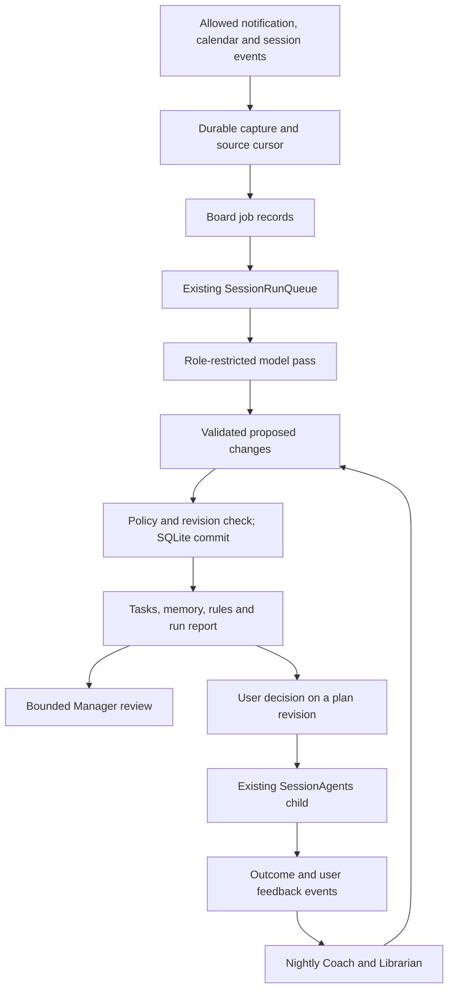

# Task board: reliable capture, memory and Manager

26 October 2026. **Implementation plan, not shipped behavior.**

Source checked: `6bf1f35b8219c8fa697831a11aa207945bb1ecb3`, branch
`test/usage-windows-on-personal1171`. This contains the tasks1170 snapshot,
personal-profile notification fix and usage-window work. The phone reports
1172; this plan does not establish a byte-for-byte match with its APK.
Preserve the profile filter, usage-window feature, PC command approvals,
existing chats, sign-ins and task data during implementation.

The source review and this plan do not prove live discovery or overnight
behavior. Existing emulator fixtures remain useful, but are not that proof.

## 1. What the user should get

The board should keep finding useful work from allowed notifications,
calendar changes and Mike conversations. The user can give work to Mike,
take it themselves, correct it, dismiss it or postpone it. A Manager explains
and organizes the board. Named team members show their work and accept direct
messages. Nightly review improves learned rules; memory upkeep compacts useful
facts dynamically. The user chooses the models.

Keep these agreed limits:

- No WhatsApp backup import or unattended screen reading. Extra conversation
  context is a visible, user-started action with a read-receipt warning.
- No quiet hours for collection/discovery. Night work waits on the board.
- Background thinking may propose and organize. It cannot approve or execute
  a task. Existing approval and Stop paths still govern execution children.
- Memory has no fixed expiry. Size, actual use, open tasks and user pins guide
  compaction. Forgetting and source exclusion are separate actions.
- No new server, general workflow engine or second run queue.

Source coverage stays explicit: email and WhatsApp use notification content,
not full mailbox or conversation sync. The initial history pass reads Mike
chats. A future mailbox connector needs its own scoped design; do not label
notification-only capture as complete email coverage.

A complete user journey is:

1. A real allowed message is captured and appears in collection status.
2. One bounded pass proposes a sourced card or records why nothing was needed.
3. The Manager can explain the evidence and exact proposed plan.
4. The user edits that plan, approves it, or keeps it as their own task.
5. The approved plan starts one ordinary child chat. Stop reaches it.
6. Its result reaches the card and Manager; the user confirms or corrects it.
7. That feedback reaches the nightly review without losing earlier comments.
8. A later related message benefits from the learned rule and memory.
9. Undoing that night preserves information added afterwards.

## 2. Findings this plan closes

| Current problem | Required behavior |
| --- | --- |
| A new chat gets a cursor at its newest update before its content is captured | Capture its eligible messages before advancing the cursor |
| Long transcripts are cut to the last 2,000 characters while the cursor advances past the rest | Page input; do not label omitted messages as handled |
| Exclusion only stops future capture | Recheck pending, queued and derived context before use |
| Undo replaces all memory with a snapshot | Revert only the revisions changed by that run |
| Fixed nightly titles collide with normal topic dedupe | One unique report per maintenance run |
| Manager gets a brief without the full plan/evidence | Add an authorized, paged `tasks/get` view |
| Coach gets only the last decision | Preserve a small feedback and outcome event log |
| Automatic roles exist mostly as chat guidance | Add a bounded event-driven Manager review |
| Snoozed Return now calls restore, which requires closed | Add a defined wake transition |
| Voice opens a normal engine session for every chat | Enforce the same run permissions in voice and typed chat |

Source entry points: [TaskDesk](../../app/src/main/java/dev/androidagent/app/TaskDesk.kt),
[TaskBoard](../../core/src/main/kotlin/dev/androidagent/core/TaskBoard.kt),
[TaskTools](../../core/src/main/kotlin/dev/androidagent/core/TaskTools.kt),
[TaskPrompts](../../core/src/main/kotlin/dev/androidagent/core/TaskPrompts.kt),
[TaskMemory](../../core/src/main/kotlin/dev/androidagent/core/TaskMemory.kt),
[TaskPlaybook](../../core/src/main/kotlin/dev/androidagent/core/TaskPlaybook.kt),
[VoiceConversation](../../app/src/main/java/dev/androidagent/app/VoiceConversation.kt).

## 3. Architecture: extend the existing app

Keep module ownership. `core` defines policy, transitions, job/change-set
contracts and context selection. `workspace` owns transactions and migrations.
`app` connects lifecycle, scheduling, engines and UI. Engines enforce their
native tool profile. `automations` extracts notifications only after the
profile/package checks. Device actions stay in `device-tools`.

Split the current large `TaskDesk` by responsibility only as work needs it:
capture, job control, context, and maintenance. Do not create new Gradle modules
or a generic agent framework for these helpers.

## 4. Durable capture and recovery

### 4.1 Define capture separately from model processing

A source item is **captured** when its bounded content and identity are saved.
It is **processed** only after its accepted output commit. A model failure
must not move the capture cursor backwards or silently discard input.

For local chats, add a narrow finalized-message change feed to `SessionStore`:
`sequence, sessionId, messageId, contentRevision, changeKind`. Record it in
the same sessions.db transaction that finalizes a user/assistant message.
Streaming tokens do not each create an event. A later edit of finalized
content gets a new revision. Read pages through an upper sequence boundary.

In one taskboard.db transaction, insert deduplicated signals and advance that
feed cursor. The two databases need no shared transaction: if the board
commit fails, read the source page again and dedupe by message ID/revision.
Do not use `updatedAt` alone, including as a timestamp tie breaker.

At enable/migration, capture the recent-chat backfill with a fixed boundary,
then consume the change feed. Overlap is safe through dedupe. Short new chats,
equal timestamps, late finalization, imports, edits and long conversations
must be covered. Page on model/context limits; include a continuation marker.
Never advance past text merely because it did not fit in the current batch.

Primary user chats and execution-child outcomes may feed discovery. Exclude
Scout, Coach, Librarian and automatic Manager bookkeeping from that feed, so
the board cannot keep rediscovering its own reports. Use run purpose rather
than fragile title suffixes for this decision.

### 4.2 Notifications have a different guarantee

Keep `PersonalNotificationPolicy` before all payload access. Use package,
profile, conversation, message identity and revision where the OS supplies
them. Where it does not, use an overlap window and content fingerprint; record
that the source is incomplete. Reposts are not new work.

Only claim durable capture after the DB write. Android may omit notifications,
and storage/network/OEM limits remain real. A full inbox or unreadable payload
must increment a visible gap counter with a reason, never appear as successful
coverage. For replayable chat input, leave the cursor in place when storage
is full. Keep bounded retention for raw input, with text-free discard receipts.
Show the existing 72-hour retention limit and any expiry without processing.

### 4.3 Persist board jobs, reuse the queue

Add a small `BoardJob` record: `id, purpose, inputRefs, sourcePolicyRevision,
baseBoardRevision, modelSelection, attempt, state, lease, nextEligibleAt,
outputCommitId, errorCode`. Suggested states: queued, running, staged,
committed, retryable, invalidated, cancelled, outcome_unknown.

Queue a job reference, not a saved prompt full of notification bodies.
Resolve its fresh context and policy immediately before engine dispatch.
The same job/attempt key reconnects to its existing receipt. New model
attempts may replay reads; unique output IDs prevent duplicate accepted writes.
Unknown execution effects still require inspection, never automatic replay.

Scout write tools must stage their output under the active job before they
return success. Commit new cards, evidence changes, notes, input acknowledgments
and the job receipt together after the final policy check. A denied or failed
commit leaves raw input retryable; finish is not allowed to acknowledge saves
that were only attempted. This discovery commit comes in step 1; maintenance
extends the same pattern in step 3.

Recover running jobs after process loss by checking existing run receipts.
Retry staged read-only work only when safe. Serialize maintenance commits,
not every app conversation. Keep JobScheduler, backoff, quotas and Stop.

## 5. Source exclusion must follow the data

Add app-owned `SourceRef` metadata to signals and derived cards, notes and
rule revisions: source kind, profile scope, package/conversation/session,
stable item/revision, and parent references. The model cannot replace these
fields with a claimed sender or an invented source ID.

Use one `SourcePolicy` implementation at capture, context selection, dispatch,
tool reads and output commit. Increment a durable revision when settings
change. Check derived context too: excluded WhatsApp content must not return
through an old summary, card or learned rule.

On source removal:

1. Commit the policy change and invalidate affected queued jobs.
2. Revoke new calls from affected active jobs, then request Stop.
3. Invalidate an entire mixed-source job. Rebuild from currently allowed
   inputs; do not ask a model to remove the forbidden parts of its own context.
4. Reject its staged output if policy changed before commit.
5. Keep existing cards and memory visible to the user, marked as excluded
   from automatic context. Do not erase them unless the user chooses Forget.

User-authored rules and plain decision codes remain separate from copied
source text. Mixed derived notes/rules stay out of model context if any
required parent is excluded. Old items without reliable lineage are treated
as unverified for automatic reuse; do not guess their Android profile.

A policy change cannot retract content already sent to a provider or undo
completed side effects. Close the race by ordering policy writes, dispatch
authorization and output commits through one policy coordinator. Define a
send that already passed this boundary as in flight, and say so in the UI.

These guarantees apply to app-managed board paths. A normal full-access chat
shares the app's Linux UID; this is not OS isolation from an explicitly
privileged chat. Do not claim otherwise.

## 6. Feedback, Manager context and execution authority

Add a small append-only `TaskEvent` log in the same transaction as each card
change: `eventId, taskId, cardRevision, kind, actor, runId, time, safePayload`.
Record user approval/take/reject/snooze/wake, note edits, Continue rounds,
child outcomes, and the user's completion verdict. Keep the existing card
as the current projection. This is not whole-app event sourcing.

Legacy cards get a clearly labelled imported-current-state event. Do not
invent lost earlier decisions. Retention must match the feedback/report
window and preserve events needed by an open task. Forget can remove personal
payloads while retaining a text-free operation receipt.

Add `tasks(mode="get", id, sections, continuation)` for plan, evidence,
deliverable, user notes, current execution, result and event history. Apply
current source policy and role scope; return explicit missing/excluded fields.
`tasks/list` remains brief. Manager checks can now compare result with plan.

Build one context envelope for typed, voice and automatic turns: role,
run purpose, allowed operations, user-input provenance, current board revision,
and bounded relevant records. It must not turn a child result, quoted source
or automatic review into a user decision. Never grant authority from a chat
title or a model-supplied `fromUser` argument.

An approval binds `taskId + planRevision + planHash + target + userNote`.
Store this immutable execution specification before dispatch. A later change
of recipient, scope, target or effects needs a new user decision. Preserve
the existing stable requestId, uncertain-outcome handling, ordinary child
chat, confirmation gates and Stop propagation.

## 7. One enforced run profile across typed and voice

Separate a member's identity from the permissions of a particular run.

| Run purpose | May do | Must not do |
| --- | --- | --- |
| Scout | Read allowed sources, stage proposals/notes/updates | Screen control, send, execute, approve |
| Coach / Librarian | Read permitted feedback/memory, stage bounded maintenance | Edit user.md, expand sources, approve work |
| Automatic Manager review | Read board changes; organize roles/assignments; post one summary | Execute tasks or delegate effectful work |
| User talking to Manager/member | Explain and accept the user's scoped task decisions | Treat quoted data as approval |
| Approved execution child | Perform the frozen approved plan with normal gates | Expand scope or repeat unknown effects |

Apply this before engine/thread open, at every app tool call, and at native
approval handling. Voice must not open a full native-tool thread for a
restricted role. Never reuse an unrestricted native thread for restricted
work. If an engine's voice mode cannot enforce the required profile, keep
that backstage member in typed mode with a clear explanation. Manager voice
still gets the same context and task scope as typed Manager chat.

Direct Scout requests should request a fresh permitted job through the app;
they must not expose raw inbox contents or silently grant screen control.
Stop invalidates dispatch first, stops the active role job and its relevant
children, and preserves receipts of completed actions.

## 8. Reversible learning and memory

### 8.1 Stage, validate, then commit

Coach/Librarian tools write a `MaintenanceChangeSet`, not live memory/rules.
It names the run, exact feedback cursor/input revisions, proposed note/rule
changes, evidence events, base revisions and a short report.

Validate source lineage, role permissions, pinned/open-task protection,
forget tombstones, allowed paths, rule size/count and rule evidence. A failure
keeps the current generation active and produces a useful error. Rejected
report creation must not leave invisible applied changes.

SQLite is the authority for active rule revisions and generation selection:

1. Build bounded immutable generation files outside the auto-loaded skills
   tree. Finish and hash-check them before activation.
2. In one SQLite transaction, recheck policy and input/base revisions; apply
   note/rule revisions, append the change journal, activate the generation,
   save the job receipt and its unique report.
3. Readers resolve the active generation through that DB reference. Crashes
   before commit leave unused files; crashes after it see the whole commit.
   A missing/hash-invalid active file blocks learned-rule loading and raises
   an error. Recovery uses a validated prior generation or rebuilds artifacts.

Keep a short stable `mike-playbook/SKILL.md` adapter directing agents to the
`tasks` reader. Do not leave old learned text at an auto-loaded fixed path.
Replace the execution prompt's direct filesystem playbook instructions with
the same authorized reader. Keep `user.md` user-owned and separately versioned.
This integration is a release gate; a DB pointer is useless if a caller still
reads an old fixed-path file.

Report identity is `report:<maintenanceRunId>` and is code-generated. Normal
topic dedupe cannot suppress it. Store the report and change set together.
The visible title can stay short and translated.

### 8.2 Undo changes, not time

Undo creates a compensating change set. Revert an item only if its current
revision is the revision written by the selected run. Preserve later additions,
later edits, user pins and linked open-task facts. Return applied, unchanged
and conflict counts, with a preview when conflicts need a choice.

Example: night changes note A; morning adds B and edits A. Undo keeps B,
does not overwrite edited A, and reports the conflict. A completed undo is
idempotent. Undoing a no-conflict run restores its affected items only.

An explicit Forget creates a tombstone that every restore/merge checks. It
also removes affected content from active generations and automatic context.
Scrub affected retained personal payloads/artifacts under that user's Forget
scope; a backup must not silently resurrect them. Keep only text-free receipts
needed for dedupe/recovery. Do not claim forensic flash erasure.

### 8.3 Learn from the actual work

Coach reads new user events since its committed cursor, relevant earlier
events and accepted execution outcomes. A machine-completed run is not the
user's success verdict. Failed attempts and user corrections remain visible.
Rules cite actual event IDs and date ranges. Source messages remain data,
never permission to change the playbook.

Librarian uses size pressure and actual recall/use counters. Preserve pinned
and open-task notes; compact detail into summaries/profiles, then retire what
is no longer useful. Process bounded pages with a fair continuation cursor,
so the same first 400 notes cannot starve the rest. No fixed expiry for live
memory. Show constraints when protected facts alone fill the budget.

Keep nightly light and weekly deeper upkeep. A missed job gets one catch-up
run with the same schedule identity, not many duplicate nights at startup.

## 9. Manager, team and UI

Trigger Manager reviews from meaningful captured events: new task patterns,
execution outcomes or user feedback. Batch a bounded event range into one
durable request. Role edits, its own report and status refreshes must not
trigger another review. Save the processed event boundary with its output.

Starting defaults, to tune after the pilot: no more than one automatic review
per 30 minutes, four per day, and only with useful new events. Repeated task
kinds can trigger a role review after about four real examples. Keep the
existing four built-ins plus at most three task roles. Assign only undecided
work automatically; leave running work with its existing execution owner.
Create/rename/merge roles with an explicit journal and user rename/remove UI.
Do not add a model call for each card refresh or animation frame.

The user chooses discovery and maintenance models. Automatic Manager review
uses the discovery selection by default, shown in settings; an advanced
override may be added. Expensive models are never silently selected. Show
job counts and measured usage where supplied. Caps prevent new runs, but do
not promise an exact monetary ceiling for tokens already in flight.

UI work is part of completion:

- Keep the calm Manager eye and family of team avatars, with useful status
  text: collecting, scheduled, processing, waiting, paused, failed, completed.
- Show last successful capture/pass, next eligible pass, pending count and
  any coverage gap. Do not show All quiet when the job has failed.
  Next eligible is not an exact wake time promised by Android.
- Add full task details and provenance, chronological feedback, and an
  explicit Wake action for snoozed cards.
- Show each member's current job, outcomes, relevant rules and direct chat.
  Add a visible Read conversation action for partial-context tasks; never
  run it from discovery and warn about read receipts before launching it.
- Show memory changes with before/after, reasons and conflict-aware Undo.
- Complete Hebrew/English text, RTL, large font, accessibility labels,
  reduced motion and dark-theme contrast. No raw exception banner as the
  only way to learn that a source stopped working.

## 10. Delivery in reviewable steps

| Step | Scope and owners | Exit condition |
| --- | --- | --- |
| 0. Freeze baseline | Confirm installed package/source, preserve personal-profile and usage-window changes; choose one feature branch from the current integrated source | Reproducible source and migration fixtures, no dirty-checkout loss |
| 1. Capture and controls | SessionStore finalized-message feed; board transactions, source lineage/policy; BoardJob records wired into the existing queue; tasks/get; snooze wake | No cursor skip, no excluded managed context, restart/dedupe tests pass |
| 2. Authority and role profiles | Coordinator, both engines, voice and context builder; immutable approved plan revision | Typed/voice parity; automatic runs cannot start effectful children |
| 3. Feedback and safe maintenance | TaskEvent journal, staged changes, DB-owned rule generations, per-run reports, compensating undo and forget | Crash/undo/conflict tests pass; no lost later notes or hidden maintenance |
| 4. Manager and product finish | Batched review triggers, bounded roles, team activity, full UI/localization | No review feedback loop; useful inspectable roles and working direct requests |
| 5. Phone validation | Exact APK delivery, installed metadata/hash, controlled full journey and recovery tests, then a 24-hour pilot | Written evidence and remaining gaps; learning quality checked separately |

Do not turn step 4 on before step 2 is proven. Steps are implementation
slices, not permission requests after each small fix. Keep unready automatic
features off behind one migration-safe flag; keep current chats usable.
Each slice must include its schema migration and meaningful regression tests.

## 11. Storage and migration rules

Extend the existing `taskboard.db` deliberately: versioned current records
plus indexed tables for the narrow event log, jobs, source cursor/lineage,
change sets/revisions and forget tombstones. Keep JSON for bounded record
payloads where useful. Avoid unindexed whole-history scans every minute.
Add the finalized-message feed to sessions.db through its own migration.

Migration is idempotent and non-destructive. Import existing cards and memory
without pretending their missing history/provenance is known. Preserve task
execution receipts and every UNKNOWN outcome. Mark legacy backstage raw
queued prompts ineligible for automatic dispatch; rebuild permitted read jobs
from stored signals instead. Leave ordinary user queues alone. Do not replay
old execution requests.

Keep user-owned rules. Import legacy learned files once into a validated
generation, with unknown-lineage rules outside automatic context until they
can be safely rebuilt from user feedback. Retain old source data in its
existing user-visible scope; no mass deletion to make migration pass.
Record counts and skipped/unreadable rows. Export only synthetic fixtures
and redacted counts for tests, never personal messages or credentials.

## 12. Required tests and evidence

| Scenario | Must be shown |
| --- | --- |
| Short new chat, equal timestamps, edited/finalized messages | Every eligible revision captured once, including after restart |
| Long conversation and full inbox | Paging/backpressure or a visible gap; no false processed cursor |
| Reposted notification and profile rejection | Dedupe; forbidden profile payload never read |
| Exclude before dispatch, during a mixed run, before commit | No new forbidden context after the policy boundary; no derived commit |
| Old excluded evidence inside a summary/rule/card | Managed context reader refuses it |
| Duplicate user tap, network loss, Stop during start | One existing child receipt; no replay of unknown effects |
| Plan changes after approval | Old approval cannot start the changed plan |
| Typed and voice for each restricted purpose | App and native capabilities stay restricted; no full-thread reuse |
| Crash at each generation/DB commit step | Old or new valid generation, never half-applied live state |
| Two consecutive nights with same report title | Two run-specific reports and correct undo targets |
| Undo after new notes, edits, pins or Forget | Later work preserved; conflicts visible; forgotten content stays forgotten |
| Approval, note edit, Continue and Done on one task | Coach sees the whole real feedback sequence |
| Manager-generated role/report events | No self-triggering review loop or repeated model spend |
| Hebrew, RTL, large font, dark/reduced motion | Real rendered screens, usable controls and truthful states |

Run targeted JVM/storage/engine tests, app lint, both APK assemblies and
regressions for preserved features. Use a fixture emulator for synthetic
instrumentation; invoke its runner directly, never AGP connected tests on
the user's phone. Keep the native read-only limitation explicit until tested
on the real ARM64 runtime. A release still needs the repository's full gate.

For the physical pilot, verify the exact installed APK first. Use controlled
messages/events and approved harmless tasks, not an automatic replay of old
personal requests. Cover notification to proposal to approval to child result
to user verdict; then maintenance and a related follow-up. Also cover screen
off, process loss, reconnect and Stop. Record missed inputs, duplicates,
latency, useful/incorrect proposals, model use and battery observations.
Compare learning against the same saved synthetic cases without the learned
rule; a model writing a rule is not proof that the rule helps.

Zero lost committed inputs, unauthorized execution, source-policy leaks in
managed paths, or undo data loss are hard gates. Delivery delays and proposal
quality need recorded pilot data and user assessment. A single 24-hour pass
is bounded evidence, not a guarantee of continuous reliability.

## 13. Bounded Astra consultation

One GPT-6-Astra consultation at medium reasoning, with a short standalone
brief and a maximum requested response of 850 words. No repository exploration,
web use, edits, extra agents or follow-up call was requested. Exact billing
and token use were not returned, so no monetary saving is claimed.

The advice incorporated here: keep one queue; distinguish capture from model
processing; carry source lineage into derived context; invalidate whole mixed
jobs; trigger Manager reviews only from meaningful events; bind approval to
the plan revision; make SQLite own the active rule generation; undo with
revision checks and forget tombstones; move voice/typed isolation before
automatic Manager behavior. The detailed design and file mapping were done
in the parent session.

This turn creates this plan only. No product code, build, installation or
data migration is part of the planning task.
