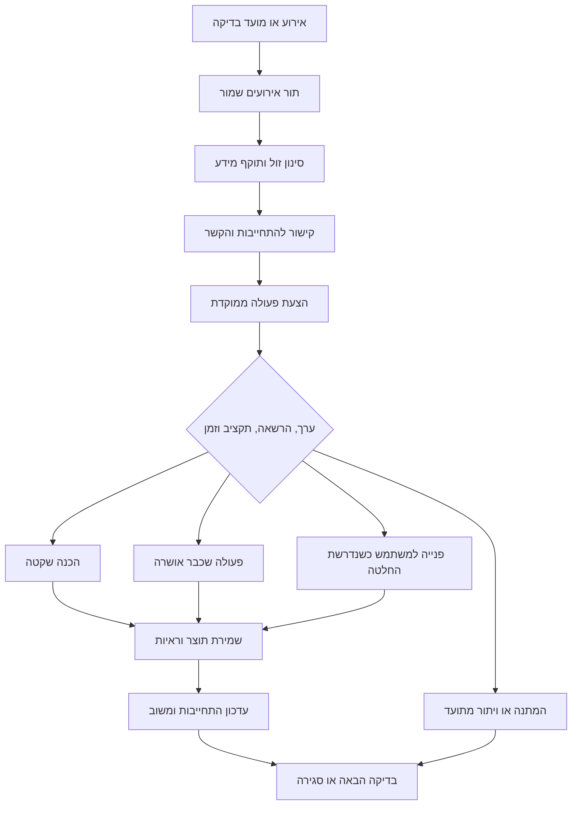

# איך להפוך את מייק לסוכן פרואקטיבי

מחקר והמלצה ארכיטקטונית · 25 באוקטובר 2026

## העמדה שלי

הדרך המתאימה למייק היא **מערכת יוזמה שמבוססת על התחייבויות, אירועים והרשאות קיימות**. היא צריכה לזכור למה התחייבנו, לזהות שינוי שיכול לקדם את העבודה, להחליט אם לפעול או להמתין, ולוודא מה קרה בפועל.

היתרון של מייק הוא החיבור בין הטלפון, המחשבים, השיחות, הקול, הכלים והאפליקציות. כדאי להפוך את החיבורים האלה לרצף של עבודה שמורה ומכוונת למטרות המשתמש. בדיקה תקופתית יכולה לעזור, אבל אינה מחליפה זיכרון של עבודה פתוחה, תור עמיד, שיקול דעת לגבי הפרעה וראיות לביצוע.

הייתי מתחיל מיכולת אחת: **מייק ממשיך לעקוב אחר עבודה שקיבל, ומתקדם כשהתנאים מאפשרים זאת, בגבולות שהמשתמש כבר אישר.** לאחר שהמסלול הזה אמין, אפשר לפתוח בהדרגה זיהוי של הזדמנויות חדשות.

כל תכנון במסמך מסומן כהמלצה; לא הוטמע קוד מוצר במסגרת המחקר.

## איך נערך המחקר ומה הוא מוכיח

שלושה סוכנים עבדו במקביל: פרויקטים וקוד פתוח; מאמרים והערכה; ובדיקת מקור של מייק. הבדיקה הראשית הוסיפה תיעוד Android, בדיקות צולבות של מאמרים ושל קוד, וגיבוש העמדה.

סוגי הראיות הופרדו:

- תיעוד מוצר מעיד על התנהגות שהיצרן מתאר. הוא אינו מדידת ביצועים עצמאית.
- קריאת מקור מראה מה הקוד שנבדק עושה או מאפשר. היא אינה הוכחת פעולה בטלפון מותקן.
- מחקר נמדד תקף להגדרה, למדגם ולמערכת שנבדקו; אין להעביר את האחוזים אוטומטית למייק.
- המלצות הארכיטקטורה והפיילוט הן הסינתזה שלי מהמקורות ומהסביבה של מייק.

לא הותקנו פרויקטים, לא הופעלו אוטומציות, ולא נערכו build או בדיקות מכשיר. קוד המוצר וההגדרות לא שונו. נוצר רק מסמך המחקר הזה.

## 1. ארבע יכולות שונות שמכונות פרואקטיביות

| סוג | דוגמה | השאלה המרכזית |
|---|---|---|
| אוטומציה בזמן קבוע | סיכום בכל בוקר | האם התזמון והביצוע אמינים? |
| תגובה לאירוע | בדיקת שינוי ב־CI של משימה מאושרת | האם האירוע רלוונטי, חדש ובתוקף? |
| המשך התחייבות | לחכות לתוצאת סוכן ואז להמשיך את העבודה | מה עדיין פתוח ומה כבר מותר לעשות? |
| יוזמה מוסקת | זיהוי עזרה שהמשתמש לא ביקש | האם היא באמת מועילה והאם זה הזמן להציע? |

למייק יש כבר חלק ניכר משתי היכולות הראשונות. ההזדמנות הקרובה ביותר היא חיזוק המשך ההתחייבויות. יוזמה מוסקת דורשת יותר זהירות בהערכת ערך, זמן והעדפות.

חשוב להפריד בין שלוש החלטות: **האם יש טעם לבדוק; האם יש טעם לעבוד; והאם צריך לפנות למשתמש עכשיו.** אפשר להכין תוצר מועיל בלי לשלוח התראה. אפשר גם לזהות בעיה ולשמור אותה לתקציר, אם אין דחיפות.

## 2. מה ללמוד מ־Grok Bot ומהפרויקטים הפתוחים

### Grok Bot

Grok Bot הוא מוצר נפרד שהושק ב־11 באוגוסט 2026. ההכרזה מתארת בוטים עם מחשב ענן, זיכרון, שיתוף עבודה ומעקב אחר עניינים פתוחים. זו הצהרת היצרן, ללא קוד פתוח שנבדק במחקר. אין לזהות אותו עם Clawdbot או OpenClaw. [הכרזת Grok Bot](https://x.ai/news/introducing-grok-bot).

הלקח המעשי החזק נמצא בתיעוד: משימה חד־פעמית מוצלחת הופכת ל־skill, ואחר כך ל־routine. הגדרת routine כוללת בעלים, זמן ואזור זמן, מקור קלט, תוצר, אישורים וטיפול במידע חסר. גם הדגמה של המשתמש מפיקה טיוטה שצריך להשלים עם כללי כשל. זה מתאים למייק: ללמוד דרך עבודה שכבר הצליחה ולהשתמש בה שוב בתחום ידוע. [Skills and routines](https://docs.x.ai/grok-bot/skills-routines-and-automations).

מוצרית, כדאי להפריד בין עבודה שמתבצעת, תוצאה שמוכנה ונושא שדורש תשומת לב. הרשאות חוזרות צריכות להגדיר תחום ברור; עצם הזיכרון של הרגל אינו הרשאה חדשה. [הגדרות והתראות](https://docs.x.ai/grok-bot/settings-and-notifications), [אישורים ופרטיות](https://docs.x.ai/grok-bot/approvals-security-and-privacy).

### OpenClaw, ולמה צריך לבדוק תאריך וגרסה

Clawdbot, Moltbot ו־OpenClaw הם שמות עוקבים של אותו פרויקט. הפרויקט נפרד מ־Grok Bot וקדם להשקתו; אין להסיק שהוא נוצר בעקבותיו. [מאגר OpenClaw](https://github.com/openclaw/openclaw).

נבדקו שתי נקודות זמן:

- בגרסה המשוחררת `v2026.10.7`, heartbeat משתמש במתזמן Automations המשותף, אך עדיין נשאר job שבבעלות המערכת עם הגדרות heartbeat ייעודיות. [תיעוד בגרסה המשוחררת](https://github.com/openclaw/openclaw/blob/v2026.10.7/docs/gateway/heartbeat.md).
- ב־`main` שנבדק ב־25.10.2026, commit `c9666f3fc88beb40a050b25a72b2b179e128e069`, heartbeat מומר ל־job רגיל עם תזמון, מדיניות, זיכרון עבודה והיסטוריה. ביטול שלו נשמר גם אחרי אתחול. ההמרה גם מסירה התנהגויות מיוחדות ישנות של דיכוי הודעות; איחוד המתזמן אינו אומר שכל מנגנוני מניעת הרעש נשארו זהים. זה ממצא מ־main, ולא הבטחה לגבי הגרסה שפורסמה. [תיעוד ההמרה בנקודה שנבדקה](https://github.com/openclaw/openclaw/blob/c9666f3fc88beb40a050b25a72b2b179e128e069/docs/gateway/heartbeat.md).

הקוד מראה שני דפוסים שכדאי ללמוד: מניעת יצירת ריצה כפולה לפי job ומשבצת זמן, וסיום אטומי של receipt, מצב job והיסטוריה. הוא גם בודק שתצורה והרשאת מקור עדיין תקפות. כל אלה נמצאים מחוץ ל־prompt של המודל. [תור הריצות](https://github.com/openclaw/openclaw/blob/c9666f3fc88beb40a050b25a72b2b179e128e069/src/cron/store/run-queue.worker.ts#L160), [סיום ריצה בטרנזקציה](https://github.com/openclaw/openclaw/blob/c9666f3fc88beb40a050b25a72b2b179e128e069/src/cron/store/run-finalization.worker.ts#L25), [בדיקת הקשר והרשאה](https://github.com/openclaw/openclaw/blob/c9666f3fc88beb40a050b25a72b2b179e128e069/src/cron/execution-context-admission.ts).

זו אינה הוכחה שכל פעולה חיצונית מתבצעת בדיוק פעם אחת. עדיין צריך להתמודד עם קריסה אחרי שליחה ולפני רישום התוצאה. [מודל השחזור](https://github.com/openclaw/openclaw/blob/c9666f3fc88beb40a050b25a72b2b179e128e069/docs/automation/cron-jobs/how-it-works.md).

### Hermes

ב־Hermes נבדקו `cron/executions.py` ו־`cron/delivery_queue.py` ב־commit `0b480ce15827300771dc35b42a6ab71bad93b446`. קיימת הפרדה בין יומן ביצוע לבין תור מסירת תוצאה. אם תהליך נופל באמצע מסירה, היא עשויה להפוך ל־`unknown`, ללא שליחה חוזרת אוטומטית. המסלול הזה קיים גם בגרסה שנבדקה `v0.22.5`. [יומן ביצוע](https://github.com/NousResearch/hermes-agent/blob/0b480ce15827300771dc35b42a6ab71bad93b446/cron/executions.py), [תור מסירה בגרסה המשוחררת](https://github.com/NousResearch/hermes-agent/blob/v0.22.5/cron/delivery_queue.py).

למייק זה לקח מרכזי: תקלה בהודעת התוצאה אינה סיבה לבצע שוב את העבודה. צריך לדעת בנפרד שהמחקר הסתיים, שהתוצר נשמר ושהמשתמש קיבל עדכון. Hermes תומך גם במשימות מתוזמנות ללא מודל, כשהבדיקה עצמה קבועה. [Scheduled Tasks](https://github.com/NousResearch/hermes-agent/blob/0b480ce15827300771dc35b42a6ab71bad93b446/website/docs/user-guide/features/cron.md).

### פרויקטים משלימים

| פרויקט ועומק הבדיקה | מה כדאי לקחת | גבול המסקנה |
|---|---|---|
| nanobot — קריאת קוד ותיעוד, commit `4701218719eb8a9206f0447006d7914f15590876` | שער נפרד שמחליט אם להודיע אחרי עבודה; פלט לא תקין מוביל לשקט | שער מודל לבדו עלול להסתיר כשל; התראה מפורשת של המשתמש צריכה מדיניות משלה. [evaluator.py](https://github.com/HKUDS/nanobot/blob/4701218719eb8a9206f0447006d7914f15590876/nanobot/utils/evaluator.py), [מגבלות Automations](https://github.com/HKUDS/nanobot/blob/4701218719eb8a9206f0447006d7914f15590876/docs/automations.md) |
| Letta — תיעוד ומאגר | עיבוד זיכרון ברקע והפרדה בין זיכרון שיחה למידע מתמשך | זיכרון טוב אינו לבדו מתזמן, מנהל הרשאות או מנגנון יוזמה. [Memory & dreaming](https://docs.letta.com/configuration/memory), [המאגר](https://github.com/letta-ai/letta) |
| Khoj — תיעוד ומאגר | UX פשוט של מחקר חוזר, אזור זמן וניהול אוטומציות | לא בוצעה בדיקה עמוקה של מנגנון הביצוע שלו. [Automations](https://docs.khoj.dev/features/automations/), [המאגר](https://github.com/khoj-ai/khoj) |

ברישיונות שנבדקו: Hermes ו־nanobot הם MIT, Letta הוא Apache-2.0, ו־Khoj הוא AGPL-3.0. אם מעתיקים קוד בפועל יש לבדוק את הרישיון המדויק של הגרסה והרכיב. ההמלצה כאן היא לאמץ עקרונות, ולהשאיר את מייק עם מנועי הביצוע שלו. [Hermes](https://github.com/NousResearch/hermes-agent), [nanobot](https://github.com/HKUDS/nanobot), [Letta](https://github.com/letta-ai/letta), [Khoj](https://github.com/khoj-ai/khoj).

נמצאו גם פרויקטים שמציגים את עצמם כחלופות פתוחות ל־Grok Bot, ובהם [tabyBot](https://github.com/gpdir16/tabyBot) ו־[OpenBot](https://github.com/pmwasim/OpenBot). עומק הבדיקה שלהם אינו מספיק להמלצה הנדסית. טבלאות השוואה שפרויקט כותב על עצמו אינן בסיס לאימות יכולות של מתחרים.

## 3. מה המחקרים באמת אומרים

| מקור | ממצא ומגבלה | ההשלכה למייק |
|---|---|---|
| Horvitz, CHI 1999 | מסגרת של תועלת צפויה, אי־ודאות בכוונת המשתמש ומחיר הפרעה; בסיס תכנוני, ללא LLM מודרני | פעולה, שאלה והמתנה הן אפשרויות תקינות. [המאמר](https://erichorvitz.com/chi99horvitz.pdf) |
| Proactive Agent, ICLR 2025 | 6,790 אירועי אימון ו־233 אירועי בדיקה. במודל המכוונן בטבלה 3: F1 של 66.47%, אבל precision של 49.78%. ההערכה נעזרת במודל שיפוט | יכולת להציע אינה מעידה על בחירה טובה. למדוד הצעות שימושיות והפרעות שווא. אלה דגמים ותנאים ישנים, לא דירוג מודלים ל־2026. [המאמר וטבלה 3](https://arxiv.org/html/2410.12361v3) |
| ProAgentBench, פברואר 2026 | מעל 28 אלף אירועים מתוך מעל 500 שעות; מפריד בין מתי לעזור ואיך לעזור. יש מגבלות אוכלוסייה ותיוג, והערכה מקוונת נרחבת עדיין נדרשת | למדוד תזמון ותוכן בנפרד. רישיון הנתונים המתואר הוא research-only ואוסר שימוש מסחרי, ניטור ופרופיילינג; אין להסיק מרישיון המאמר היתר לנתונים. [המאמר, מגבלות ושימוש בנתונים](https://arxiv.org/html/2602.04482v2) |
| ProAgent, גרסה 2 ממאי 2026 | חישה מדורגת לפי צורך, הקשר והעדפות, ובקרה על מסירת עזרה. מחקר המשתמשים כלל 20 משתתפים | להתחיל מסימנים זולים ולבקש הקשר עשיר רק כשנדרש. אין הצדקה להפעיל צילום או האזנה רציפים כדי לחקות את המחקר. [המאמר](https://arxiv.org/html/2512.06721v2) |
| LongMemEval, ICLR 2025 | 500 שאלות על זיכרון, עדכונים, זמן והימנעות; חלון הקשר ארוך אינו מבטיח זיכרון מתמשך אמין | לכל התחייבות צריך מקור, זמן, מצב ביטול ועדכון. מה שנאמר בעבר אינו בהכרח נכון או רצוי היום. [המאמר](https://arxiv.org/html/2410.10813v2) |
| Training Proactive and Personalized LLM Agents, גרסה מעודכנת ב־2026 | משלב תקשורת, יוזמה והתאמה; מחקר עם 33 משתתפים, כולל תלונות על שאלות עודפות ולולאות | יש להבחין בין יוזמה בזמן משימה לבין התחלת עבודה עצמאית ברקע. אין להסיק ששאלות רבות יותר הן התקדמות. [המאמר](https://arxiv.org/html/2511.02208v2) |
| AgentDojo | benchmark של משימות וכלים עם תוכן זדוני שמגיע ממקורות חיצוניים | לבדוק הצלחת עבודה ושמירת גבולות תחת מתקפה, לצד הצלחה רגילה. [המאמר](https://arxiv.org/html/2406.13352) |
| CaMeL, גרסה 2 מיוני 2025 | מפריד זרימת שליטה מנתונים זרים ומפעיל מדיניות בזמן קריאת כלי; הערבויות מוגבלות למודל האיום ולסביבה שלו | מקור והרשאה צריכים להגיע לשער הכלים בצורה מובנית. אין להסתפק בהנחיה בטקסט שהמודל יכול לפרש. [המאמר](https://arxiv.org/html/2503.18813v2) |
| Who Is Your Agent Serving?, אוקטובר 2026 | קדם־פרסום שמדגים איך ספק חיצוני יכול להסיט המלצות של סוכן, גם בלי הרשאה חדשה; נעשה שימוש במשתמשים מדומים | לבדוק גם את מקור המטרה שהסוכן מקדם. המלצה יכולה להישמע אישית ועדיין לשרת תוכן חיצוני. אין להסיק מהניסוי שיעור השפעה על בני אדם. [המאמר](https://arxiv.org/html/2610.05266v1) |

יש כמה benchmarks שונים בשם ProactiveBench; אין לחבר ביניהם תוצאות. גם המילה proactive משמשת לעזרה מסביבת עבודה, תגובה לווידאו או בקשת מידע בזמן משימה. לכן אין כיום בסיס מהמקורות האלה להכריז על דגם אחד או מרווח heartbeat אחד כבחירה הטובה ביותר למייק.

## 4. מה כבר קיים במייק

### גבולות בדיקת המקור

תיקיית העבודה הראשית הייתה ב־HEAD `d91ab4105cc5b06fb72fc301b16797d042d25ec8`, עם שינויים קיימים, ולא כללה את תשתית האוטומציות החדשה. לא שינינו או ניקינו אותה.

הבדיקה העדכנית הסתמכה על worktree קיים ונקי:

`C:\Users\SHIRA\.codex\worktrees\pc-sensitive-command-approvals-20261025`

HEAD: `e6171bd30056cf3c615da7a380ccae0b9f80c542`. מספר הגרסה במקור הוא 1164; תמונת המצב שסופקה מהטלפון דיווחה על 1167. **לא הוכחה זהות בין המקור שנבדק לבין ה־APK המותקן.** כל ממצאי הקוד בסעיף הזה מתייחסים ל־worktree האמור.

| קיים בקוד | משמעות |
|---|---|
| `AutomationLibrary`, `AutomationRule`, `AutomationEvaluator`, `AutomationRunner` | שמירת חוקים, תנאים, החלטה וביצוע נפרדים, ובדיקת dry-run |
| `AutomationAlarms` ו־`catchUp` | תזמון משותף והשלמת משבצות זמן בתוך חלון תוקף |
| מקורות התראה ומצב מכשיר | אירועי מסך, טעינה, Bluetooth ו־Wi-Fi; אין צורך במודל לכל שינוי |
| `agent_turn`, `notify`, `ask`, `voice_call`, workflow | כבר קיימים מסלולי עבודה ופנייה למשתמש |
| שיחה נפרדת לכל חוק | אפשר לשמור רצף עבודה בלי להכניס אותו לשיחה הנוכחית |
| `SessionRunQueue` | תוקף לעבודה, שמירה והשהיה לאחר שחזור |
| `AgentRuns`, `DeviceLease`, Stop | חשיבה בשיחות מקבילות לצד בלעדיות על המסך וביטול |
| workflows וילדים/משימות מחשב | רצפים חוזרים, המשך מתוצאה קיימת ומפתחות בקשה יציבים |
| Mike Connect | קריאת capabilities ופעולות דרך הרשאות; חיבור קיים אינו subscription לאירועים |

ראיות מרכזיות: [AutomationRule.kt](C:/Users/SHIRA/.codex/worktrees/pc-sensitive-command-approvals-20261025/core/src/main/kotlin/dev/androidagent/core/AutomationRule.kt:295), [AutomationHost.kt](C:/Users/SHIRA/.codex/worktrees/pc-sensitive-command-approvals-20261025/automations/src/main/kotlin/dev/androidagent/automations/AutomationHost.kt:139), [AndroidAutomationActions.kt](C:/Users/SHIRA/.codex/worktrees/pc-sensitive-command-approvals-20261025/automations/src/main/kotlin/dev/androidagent/automations/AndroidAutomationActions.kt:123), [AgentRuns.kt](C:/Users/SHIRA/.codex/worktrees/pc-sensitive-command-approvals-20261025/core/src/main/kotlin/dev/androidagent/core/AgentRuns.kt:61).

### הפערים בעלי הערך הגבוה ביותר

**1. דחייה אינה תמיד המתנה שמורה.** ב־`AutomationHost.onEvent` מבוצעות רק תוצאות `Fired`. אירוע שנפסל כשהסוכן עסוק או כשהמשתמש לא זמין אינו נשמר שם בתור לבדיקה חוזרת. `catchUp` מייצר אירוע Clock בלבד. לתזמון יש השלמת משבצת; לא נמצא מנגנון מקביל שמשמר התראה שנדחתה. זו מסקנת מקור, ללא שחזור פיזי במחקר הזה. [AutomationHost.kt:171](C:/Users/SHIRA/.codex/worktrees/pc-sensitive-command-approvals-20261025/automations/src/main/kotlin/dev/androidagent/automations/AutomationHost.kt:171).

**2. חסר מנהל התחייבויות לאורך זמן במסלול האפליקציה שנבדק.** אין שם מערכת מלאה של מטרה, תלות, המתנה לשינוי, בדיקה הבאה ועדות לסגירה. כלי goal של Codex במחשב אינם מוכיחים שהאפליקציה מנהלת כך עבודה עצמאית. התיעוד במקור שנבדק מציין מגבלה על continuation turns שאינם בבעלות ה־coordinator. [הארכיטקטורה בעותק העדכני](C:/Users/SHIRA/.codex/worktrees/pc-sensitive-command-approvals-20261025/docs/ARCHITECTURE.md:990).

**3. רישום הפעלה אינו ראיית הצלחה.** `AutomationJournal` שומר timestamps, והרישום נעשה לפני הפעולה. כשל שמירת journal נבלע במסלול שנבדק. זה עוזר לצמצם כפילויות אך אינו מבטיח ביצוע פעם אחת או תוצאה מוצלחת. גם callback התוצאות אינו מחובר במסלול האתחול שנבדק. [AutomationJournal.kt:120](C:/Users/SHIRA/.codex/worktrees/pc-sensitive-command-approvals-20261025/core/src/main/kotlin/dev/androidagent/core/AutomationJournal.kt:120), [AutomationHost.kt:92](C:/Users/SHIRA/.codex/worktrees/pc-sensitive-command-approvals-20261025/automations/src/main/kotlin/dev/androidagent/automations/AutomationHost.kt:92).

**4. רקע Android דורש חיזוק ובדיקה.** receivers של alarm ו־boot מפעילים מסלול שמשגר coroutine וחוזרים, ללא `goAsync` או מסירה ל־Worker. זה סיכון lifecycle; לא תקלה שהוכחה במכשיר. [AutomationAlarms.kt:104](C:/Users/SHIRA/.codex/worktrees/pc-sensitive-command-approvals-20261025/automations/src/main/kotlin/dev/androidagent/automations/AutomationAlarms.kt:104).

**5. זמינות המשתמש מחושבת בצורה גסה.** מסך דלוק ולא נעול אינו מספיק כדי לדעת אם ראוי לדבר. אין שם מדיניות מלאה של הפרעה, פגישה או תקציב פניות. [AutomationHost.kt:255](C:/Users/SHIRA/.codex/worktrees/pc-sensitive-command-approvals-20261025/automations/src/main/kotlin/dev/androidagent/automations/AutomationHost.kt:255).

**6. יש מגבלות לחוק בודד, וחסר תקציב כולל ליוזמה.** הקוד מאפשר שיחות מקבילות ומגביל את משאב המסך בנפרד. לכן צריך cap חוצה חוקים לעבודה יזומה: ריצות, זמן, שימוש במודל ופניות למשתמש. [AutomationRule.kt:435](C:/Users/SHIRA/.codex/worktrees/pc-sensitive-command-approvals-20261025/core/src/main/kotlin/dev/androidagent/core/AutomationRule.kt:435), [AgentRuns.kt:143](C:/Users/SHIRA/.codex/worktrees/pc-sensitive-command-approvals-20261025/core/src/main/kotlin/dev/androidagent/core/AgentRuns.kt:143).

**7. צריך ייחוס מובנה של מידע.** מסלול `agent_turn` ממלא placeholders ושולח prompt כתור רגיל. יש הנחיה כללית להתייחס להתראות כנתונים זרים, אך ההמלצה היא להעביר בנפרד הוראה מאושרת, אירוע חיצוני והרשאה. כך טקסט התראה לא יקבל בטעות מעמד של בקשה חדשה מהמשתמש. [AndroidAutomationActions.kt:159](C:/Users/SHIRA/.codex/worktrees/pc-sensitive-command-approvals-20261025/automations/src/main/kotlin/dev/androidagent/automations/AndroidAutomationActions.kt:159), [AgentCoordinator.kt:458](C:/Users/SHIRA/.codex/worktrees/pc-sensitive-command-approvals-20261025/core/src/main/kotlin/dev/androidagent/core/AgentCoordinator.kt:458).

**8. יש יכולות מתוארות שעדיין אינן מקור אירוע פעיל.** `place` רדום במקור שנבדק. Mike Connect מציע `list/describe/call`, ולא נמצא שם חוזה subscription. הצעה כמו מעקב אחרי שינוי ב־Ghostride או LumaStand דורשת אירוע חתום מהאפליקציה או בדיקה יזומה מורשית; עצם החיבור לאפליקציה אינו מספק זאת. [AutomationHost.kt:131](C:/Users/SHIRA/.codex/worktrees/pc-sensitive-command-approvals-20261025/automations/src/main/kotlin/dev/androidagent/automations/AutomationHost.kt:131).

## 5. הלולאה שאני ממליץ לבנות

המתזמן עובד על מצב שמור גם בלי מודל. מודל נדרש כאשר יש צורך לפרש שינוי, לתכנן או לבצע משימה חדשה. workflow מוכר נותר דרך הביצוע המועדפת לרצף שכבר הוגדר.

### זיכרון של התחייבות

לכל התחייבות מוצע לשמור:

| שדה | תפקיד |
|---|---|
| מזהה, בעלים ותחום עבודה | למנוע שאותה עבודה תנוהל בנפרד בטלפון ובמחשב |
| נוסח המשתמש ומקור ההוראה | לשמר בדיוק מה התבקש ומאיזו שיחה הגיע |
| מטרה ותנאי הצלחה | להגדיר מתי מותר לסמן שהעבודה הושלמה |
| הרשאה וגרסתה | אילו כלים ופעולות כבר אושרו; תנאי ביטול ותוקף |
| תלות ואירוע צפוי | למה מחכים ומה יכול לפתוח את הצעד הבא |
| `nextCheckAt`, deadline ותוקף | מתי לבדוק ומתי המידע או הבקשה כבר ישנים |
| תקציב | ריצות, זמן, שימוש במודל ומשאבים רלוונטיים |
| מצב וראיות | תוצר, תוצאת כלי, אי־ודאות וסיבת המתנה או סגירה |
| מדיניות מסירה | שיחה, תקציר, התראה או קול לפי בחירת המשתמש |

משימה שהמשתמש הורה להמשיך יכולה להפוך להתחייבות פעילה בתחום שכבר אושר. צורך שהמודל רק הסיק יתחיל כמועמד להצעה, בלי להרחיב סמכות. אין להפוך כל שיחת רעיונות למטרה מתמשכת.

אין צורך להתחיל מגרף ידע גדול או ממסגרת סוכנים נוספת. בסיס נתונים מובנה עם מקורות, זמנים ומצבים יכול להספיק לגרסה הראשונה. חיפוש סמנטי יהיה כלי לשליפת הקשר, ולא המקור היחיד לשאלה מה עדיין מותר או פתוח.

### תור אירועים ותור מסירה

אירוע מקבל מזהה יציב, מקור, זמן, רמת אמון, נתונים מינימליים, `notBefore`, תוקף וסטטוס טיפול. עדכונים של אותו אירוע מתמזגים כאשר מתאים. מועמד שנדחה בגלל עומס מקבל סיבה ומועד בדיקה; הוא אינו נעלם ואינו רץ מאוחר אחרי שאיבד רלוונטיות.

תוצאת עבודה ותוצאת מסירה נשמרות בנפרד. יומן הביצוע צריך להבחין בין: תוכנן, נתבע לביצוע, התחיל, הושלם עם ראיה, נכשל, או תוצאה לא ידועה. שדות מסירה מתארים בנפרד אם נשמר תוצר ואם נמסרה התראה.

אחרי timeout של פעולה שיש לה תופעת לוואי, מבצעים בירור מצב לפני ניסיון נוסף. כשאין דרך לברר, שומרים `unknown`. יצירת משימה, שינוי או שליחה אינה מקבלת הבטחת exactly-once רק מפני שהמתזמן שמור.

דפוסים דומים מופיעים במערכות תזמור: Temporal שומר היסטוריית ביצוע ומבודד פעולות חיצוניות; LangGraph מפריד checkpoints של ריצה מזיכרון בין שיחות. אפשר ללמוד מהם בלי להוסיף אותם כתלות למייק Android. [Temporal: Tasks](https://docs.temporal.io/tasks), [LangGraph: Persistence](https://docs.langchain.com/oss/python/langgraph/persistence).

## 6. איך מחליטים אם לפעול או לפנות

לכל מועמד מוצעות חמש אפשרויות: להתעלם, להמתין, להכין בשקט, להציג, או לבצע במסגרת הרשאה קיימת. שאלת אישור נכנסת רק כשחסרה החלטה או סמכות מהותית; היא אינה דרישה חדשה לכל צעד שכבר אושר.

החלטת הערך משקללת קשר למטרה, חידוש, דחיפות, תוקף המידע, סיכוי להצלחה, מחיר חישוב ומחיר הפרעה. אלה מאפייני החלטה שיש לכייל בפיילוט. ציון ביטחון שהמודל המציא אינו הסתברות מכוילת.

**מדיניות הרשאה היא תנאי קשיח לפני הפעולה.** ציון תועלת גבוה אינו עוקף אותה. מידע שמגיע מהודעה או אתר רשאי לעדכן עובדות, אך אינו מעניק הרשאה, מבטל מגבלה או יוצר מטרה בשם המשתמש.

העדפות שנלמדות צריכות להיות תלויות הקשר: לא עכשיו, לא בנושא הזה, כבר טיפלתי, או מועיל. דחייה אחת אינה בהכרח איסור קבוע. התעלמות אינה אישור, וסיום שיחה אינו הרשאה לפתוח אותה מחדש ללא גבול.

מבחינת UX, אני ממליץ על מקום אחד שמציג: מה מייק עוקב אחריו, מה הוא הכין, מה ממתין להחלטה ומתי הוא מתכוון לבדוק שוב. לכל יוזמה הסבר קצר: איזו התחייבות היא מקדמת ואיזה שינוי התרחש. מתוך אותו מקום אפשר לשנות תדירות, תחום וערוץ מסירה.

צריך להבחין בין Stop למשימה פעילה, השהיית יוזמה עד זמן מסוים, כיבוי יוזמה בנושא וביטול ההתחייבות עצמה. כל שינוי נשמר. ביטול אינו נמחק מאוחר יותר על ידי תהליך שמנסה להיות מועיל.

## 7. התאמה לטלפון, Pc ו־Server

החלוקה המומלצת היא:

- **הטלפון:** בעלות על הרשאות מקומיות, מצב המשתמש, מסירה והפעלה של כלי מכשיר. `DeviceLease` ממשיך לשמור על משאב המסך.
- **Pc:** עבודה שצריכה קבצים, סביבת פיתוח או כלים מקומיים. עבודה יזומה אינה מניחה שהמחשב ער או שיש session שולחני זמין.
- **Server, אם המשתמש בוחר שירות מתמשך:** בדיקות רשת ועבודות ארוכות שאינן זקוקות למסך הטלפון. עצם היותו מחובר עכשיו אינה הוכחה לזמינות רצופה.

לכל התחייבות בעלים אחד וסמכות ביצוע מוגדרת. מעבר מכשיר משתמש ב־claim ובגרסת סמכות; תהליך שהתנתק אינו ממשיך לפעול עם הרשאה ישנה. המקביליות של סוכנים משניים מוגבלת בתקציב ובסמכות ההתחייבות הראשית. היא אינה משכפלת את התקציב לכל ילד.

הטופולוגיה הראשונה צריכה להיות פשוטה: מצב ושליטה מקומיים בטלפון, ומשימות מחשב דרך המסלולים הקיימים. שירות רציף בשרת הוא הרחבה אפשרית לבדיקות שצריכות לעבוד גם כשהטלפון ישן. אין צורך להפוך אותו לתנאי לכל יוזמה.

### מגבלות Android שחייבות להשפיע על התכנון

Periodic WorkManager מוגבל למרווח של לפחות 15 דקות, והזמן בפועל תלוי באילוצים ובמערכת. הוא מתאים לתחזוקה ולהשלמת עבודה, ולא להבטחת תגובה מדויקת כל דקה. [Define work requests](https://developer.android.com/develop/background-work/background-tasks/persistent/getting-started/define-work).

AlarmManager מתאים למועדים, אך exact alarms דורשים הצדקה והרשאה לפי סוג המקרה. אין צורך לבקש exact alarm לכל בדיקת רקע של סוכן. [Schedule alarms](https://developer.android.com/develop/background-work/services/alarms).

הפעלת foreground service מהרקע מוגבלת, ויש כללים נוספים למיקרופון ולהרשאות while-in-use. לכן יוזמה קולית צריכה לכבד את מצב Android ואת בחירת המשתמש; במקרה שאי אפשר להתחיל שיחה, ניתן לשמור תוצאה ולהציג התראה מתאימה. [הגבלות התחלה מהרקע](https://developer.android.com/develop/background-work/services/fgs/restrictions-bg-start).

receiver צריך להשלים עבודה קצרה או למסור עבודה ממושכת למסלול שהמערכת מנהלת. שיגור coroutine לבדו אינו התחייבות של מערכת ההפעלה לשמר אותה. גם `goAsync` אינו מנגנון לעבודה בלתי מוגבלת. [BroadcastReceiver](https://developer.android.com/reference/android/content/BroadcastReceiver), [הנחיות ANR](https://developer.android.com/topic/performance/issues/anr).

ב־Android 16 יש גם מכסות שמשפיעות על workers ארוכים, לרבות כאלה שמשתמשים ב־foreground service. יש לתכנן חידוש מהמצב השמור. [Long-running workers](https://developer.android.com/develop/background-work/background-tasks/persistent/how-to/long-running).

נדרשת הרשאת גישה להתראות כדי להשתמש במאזין; עצם מוכנות כלי המכשיר אינה מעניקה אותה. גם כשהיא קיימת, המאזין אינו מקור להיסטוריית התראות מלאה או לכל התוכן באפליקציה. [NotificationListenerService](https://developer.android.com/reference/android/service/notification/NotificationListenerService).

## 8. עלות, פרטיות ושיקול דעת

מוצע סינון בשלוש רמות:

1. קוד זול: הרשאה, תוקף, כפילות, שינוי אמיתי, התחייבות פתוחה ותקציב.
2. החלטה מצומצמת: רק ההקשר שדרוש לבחירת צעד. אפשר להשתמש במודל חסכוני מתוך האפשרויות שכבר זמינות, לאחר מדידה.
3. סוכן מלא: רק לעבודה שנבחרה ודורשת תכנון או ביצוע מורכב.

לא הייתי מוריד מודל נוסף או מפעיל שירות כבד קבוע רק בשביל ההחלטה הראשונה. גם בדיקה בלי מודל צריכה מגבלה על polling, רשת, אחסון וסוללה.

ברירת המחדל לאיסוף תהיה מקורות שהמשתמש בחר ונתונים שנדרשים להתחייבות. התראות רלוונטיות נשמרות באופן מצומצם ולזמן מוגבל. צילום מסך או הרחבת הקשר נעשים כשיש צורך ומשמעות למטרה, ולא כמנגנון תיעוד רציף של חיי המשתמש.

לכל מועמד נשמרת שרשרת מקור: מטרה של המשתמש, אירוע שהציף אותה, עובדות שנאספו והכלים המורשים. זה מגן גם מפני שינוי סמוי של המטרה. מחקר האבטחה החדש על סוכנים פרואקטיביים מראה מדוע הגבלת פעולות בלבד אינה מספיקה: אפשר להשפיע על עצם ההמלצה בלי לבצע פעולה אסורה. [Who Is Your Agent Serving?](https://arxiv.org/html/2610.05266v1).

## 9. סדר היישום המומלץ

| שלב | תוצאה רצויה | תנאי מעבר |
|---|---|---|
| 1. אמינות הבסיס | תור אירועים שנדחו, attempt IDs, תוצאה מול מסירה, טיפול בכתיבה שנכשלה וב־Android lifecycle | בדיקות שחזור וכפילות עוברות; אין הצגת queued כהצלחה |
| 2. התחייבויות מפורשות | שמירת עבודה פתוחה, תנאי המתנה, בדיקה הבאה, הרשאה וביטול | אפשר להסביר למה כל ריצה התחילה ומתי היא מסתיימת |
| 3. מצב תצפית | מייק רושם אילו הצעות היה נותן, בלי לפנות או לפעול | מדגם מתויג מראה רלוונטיות ומחיר הפרעה סבירים |
| 4. עזרה שקטה | הכנה, תוצרים וסיכום שינויים בתחומים שנבחרו | תוצרים שימושיים, עלות מוגבלת ומשוב נשמר |
| 5. פעולה חוזרת מורשית | רצפים שכבר הוכיחו עצמם פועלים לפי הרשאה קיימת | תוצאה ניתנת לאימות; recovery אינו משחזר פעולה לא ידועה |
| 6. יוזמה מוסקת | הצעות חדשות מהקשר, עם סף גבוה ויכולת לשתוק | תועלת לאורך זמן בלי עלייה בהפרעות ובתיקונים |

בעלות קוד מוצעת: חוזים והחלטה ניטרלית ב־`core`; אחסון מתמשך בשכבת workspace/store לפי דפוסי הפרויקט; מקורות ומנגנוני Android ב־`:automations`; UI והגדרות ב־`app`. כל פעולת מכשיר ממשיכה לעבור דרך `device-tools`. אין ליצור שער פעולה מקביל.

הערכת זמנים לפיתוח מחייבת תכנון נפרד על branch עדכני. המחקר אינו מספק בסיס למועד סיום אמין.

## 10. פיילוטים שמתאימים למייק

אלה דוגמאות לתכנון, ולא משימות או כללים שהופעלו:

**מעקב אחר עבודה במחשב.** המשתמש מבקש לעקוב אחרי משימה. סיום child או שינוי בסטטוס פותח בדיקה ממוקדת. מייק מוודא את התוצאה, מתקדם בצעדים שאושרו ומציג רק התקדמות משמעותית. מיזוג או פרסום תלויים בהיקף ההוראה שכבר ניתנה.

**הכנה לפגישה.** במסגרת תחום שאושר מראש, מייק מזהה אירוע עתידי, אוסף רק את החומרים המתאימים ומכין תקציר. אפשר להכין מוקדם ולהציג בזמן שנבחר. קריאת יומן וחשיפת פרטים נשארות תלויות בהרשאות ובמקורות הזמינים.

**מחקר מתמשך.** מייק עוקב אחרי מקורות שנבחרו בנושא פעיל, שומר baseline ומדווח על שינוי מהותי עם מקור. שינוי בתאריך סריקה בלבד אינו סיבה לעדכון. אם אין חדש, נרשמת בדיקה שקטה.

**אפליקציות מחוברות.** בעתיד, Ghostride או LumaStand יכולות לשלוח אירוע מוגדר שמייק קישר להתחייבות. כיום אין להסיק מחיבור `list/describe/call` שקיים זרם כזה. צריך להוסיף חוזה אירועים, גרסאות והרשאות, או להשתמש בבדיקות ממוקדות שהמשתמש אישר.

הייתי בוחר תחילה בפיילוט המחשב או המחקר המתמשך: יש מטרה ברורה, תוצר שאפשר לבדוק ויכולת למדוד מתי העדכון עזר. אלה גם מסלולים שבהם ניתן להפיק ערך בלי לתפוס את מסך הטלפון.

## 11. איך נדע שהפכנו את מייק למועיל יותר

יש למדוד שלושה דברים בנפרד: איכות ההחלטה להתחיל, איכות העבודה ואיכות התזמון של הפנייה.

| מדד | מה הוא מונע |
|---|---|
| חלק ההצעות שהמשתמש מצא מועילות | אופטימיזציה לכמות יוזמות |
| הפרעות מיותרות ומספר פניות לכל נושא | רעש וחזרתיות |
| הזדמנויות שהוחמצו במדגם מתויג | מערכת שמצליחה במדד כי היא תמיד שותקת |
| השלמות עם ראיית כלי | סימון עבודה כתוצאה מוצלחת רק כי הוכנסה לתור |
| פעולות כפולות ותוצאות לא ידועות | שחזור עיוור אחרי קריסה |
| פניות אחרי ביטול או אחרי פקיעת תוקף | מטרות ישנות שחוזרות לחיים |
| זמן, שימוש במודל, סוללה ורשת לכל תועלת | לולאת רקע שמחירה גדול מהתועלת |
| תיקונים, עצירות והסברים חוזרים | העברת עבודת הניהול למשתמש |
| פעולות מעבר להרשאה | יוזמה שמרחיבה סמכות מעצמה |

יעדי הפיילוט ייקבעו עם המשתמש. אפשר להתחיל בתקציב קטן של פניות לא דחופות ובכמה תחומי עבודה בלבד; מספר ספציפי אינו תוצאה מדעית מהמאמרים שנבדקו.

בדיקות האמינות החשובות: מסך נעול, Doze, תהליך שנפל, reboot, מידע שפג תוקפו, שעון ואזור זמן שהשתנו, רשת שנעלמה אחרי תחילת פעולה, הודעה שמגיעה פעמיים, שינוי הרשאה בזמן המתנה, וסוכן פעיל שמחזיק את המסך. יש לבדוק גם הוראה זדונית בתוך אירוע חיצוני וביטול שמגיע לפני הביצוע.

בדיקות אלו הן תוכנית לעבודה עתידית. אף אחת מהן לא בוצעה על המכשיר במסגרת המחקר הזה.

## ההחלטה המומלצת

לבנות על המערכת הקיימת של מייק ולהוסיף תחילה **התחייבויות שמורות, תור אירועים עמיד, תוצאות מאומתות וניהול מסירה ותשומת לב**. להשתמש במודל כדי לפרש ולתכנן כשצריך, ובקוד כדי לשמור תוקף, תקציב, הרשאות ועקביות.

כך מייק יוכל להיות פרואקטיבי בצורה שהמשתמש מרגיש כעבודה שמתקדמת: הוא זוכר מה פתוח, מתעורר בגלל שינוי רלוונטי, מבצע את מה שכבר הותר, ופונה כשיש תוצאה או החלטה שבאמת צריכות את המשתמש.
