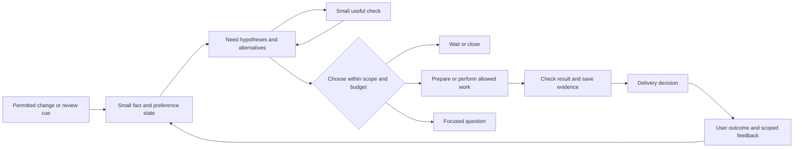

# Proactive Mike: the decision after the deeper research

25 October 2026. Research and proposed design only. This document combines three independent child-chat reports. It does not authorize implementation or enable background work.

## Read this first

**Give Mike a small, approved area of responsibility, then let it discover and finish useful work inside it.** Add this ability to the existing engines and tools. Keep durable execution, cancellation, result checks, and delivery as shared services. Start on the phone; add a Server owner only for tasks that need availability the phone cannot provide.

The earlier report focused too much on continuing explicit commitments. That is useful, but it would leave part of the user's request unanswered. A proactive assistant must also notice a missing preparation, a new obstacle, or a useful connection that has no task record yet. The central experiment is whether this discovery adds enough useful help to justify its observation and attention costs.

The detailed evidence is in:

| Report | What it covers |
|---|---|
| [Existing systems and code](01-ecosystem-and-code.md) | Grok Bot; deep code traces through OpenClaw, Hermes, and nanobot; Letta Code and Khoj; pinned commits, release differences, failures, and recovery |
| [Science and evaluation](02-science-and-evaluation.md) | 21 paper reviews; methods, baselines, results, limits, data rights, six scenarios, and a falsifiable evaluation plan |
| [Mike architecture](03-mike-architecture.md) | The actual event-to-tool path; missing boundaries; phone/Server/hybrid choices; schemas, ownership, Stop, Android limits, migration, and pilot gates |

Use this synthesis for the decision. Use the chapters to inspect the claims and implementation proposal. The first report remains historical context; this recommendation revises its development priorities.

## What the evidence changes

There are four different abilities to build and measure:

1. **Notice:** find a useful need from permitted evidence, including needs without an open commitment.
2. **Choose:** decide whether to inspect, prepare, act, ask, wait, or drop it.
3. **Complete:** carry out the chosen work and check its result.
4. **Reach:** deliver the result at a useful time and through a working route.

Better task execution does not establish better discovery. For example, pi-Bench explicitly scores hidden-intent resolution separately from completion. It uses simulated users and controlled tasks; it does not establish long-term benefit for Mike's user. [pi-Bench v3](https://arxiv.org/html/2605.14678v3).

Remembering a fact also differs from noticing when it becomes useful. ProMemAgent proposes prospective cues and links between earlier events and later developments. This suggests a useful memory design, while its benchmark results remain separate from a deployed personal assistant. [ProMemAgent](https://arxiv.org/abs/2610.27400).

The open systems supply valuable execution mechanisms, rather than proof that they infer every user's needs correctly. OpenClaw has occurrence receipts and admission checks; Hermes separates work from delivery and keeps per-job state; nanobot separates a heartbeat's work from its notification decision. Their recovery policies differ. In particular, replaying an incoming event and retrying an outgoing message must not share one blanket rule. See the pinned code and failure traces in [the systems report](01-ecosystem-and-code.md).

Grok Bot provides a useful product model: reusable skills, an owning Bot, routines, run history, and visible results. Its documented path starts by making a one-time task reliable, then saving and scheduling the method. Its closed implementation does not let this review verify the internal discovery or recovery algorithm. [Official skills and routines documentation](https://docs.x.ai/grok-bot/skills-routines-and-automations).

## The product contract

An area of responsibility should name the purpose, allowed sources, allowed work, useful limits, and where results belong. It should preserve the user's original wording. Normalized goals and inferred preferences belong in separate fields.

An illustrative future scope is: prepare briefings for selected project meetings, using a named calendar and project folder, without sending them. This is an example, not an instruction received from the user. Within such a scope, a meeting without a briefing can create new work even though nobody created a reminder. A routine is one possible implementation after the pattern proves useful.

Existing authority should carry across steps. The user should not have to approve the same research, reading, or preparation repeatedly. New sources or effects still follow their real tool and platform policy. Access to an app, a computer, or an Android permission is not by itself a standing purpose to inspect everything.

The user needs one place to see what Mike watches, what it prepared, what it plans to check next, and what needs a decision. It should support useful distinctions: stop this attempt, pause this subject, mark this instance handled, and stop this kind of assistance. These commands should update durable state rather than disappear into a model summary.

## The mechanism to test

Use two cooperating loops over the same state. The execution loop keeps adopted work moving. The discovery loop compares selected evidence with the desired state and forms new candidates. Discovery can run in an ordinary bounded model turn; it does not require a new model family or a continuously thinking process.

Generate candidates from missing prerequisites, conflicting current facts, newly available options, repeated friction, useful old facts, and capability changes. For each candidate retain the supporting facts, at least one plausible reason it may be wrong, a cheap next step, an expiry, and a key connecting it to earlier rejection or completion. A generic claim that something may help is weak evidence.

Choose observations by whether their answer could change the next action. Check existing state first, then narrow metadata, then a relevant read, and only then a focused interaction if justified. The value-of-information paper supports comparing expected decision benefit with communication cost, but its predefined choices and simplified costs do not solve open-ended question generation or provide calibrated user probabilities. [Value of Information](https://arxiv.org/html/2601.06407v1).

For Mike, an estimated value is initially a review/ranking aid. A model's confidence number should not decide authority. The code checks scope, source versions, suppression, deadlines, cost reservations, and effect policy before dispatch.

The planner's execution profile also needs enforcement. Calling a turn read-only in a prompt does not remove Codex or Claude's native file and shell powers. A planner must run with tested restricted capabilities, or in a constrained worker exposing only the permitted reads. Its proposed goal and evidence must be checked before the normal executor receives work. The phone gateway alone cannot constrain an arbitrary command already running on Pc.

Choose the next check explicitly: on a named event, at a useful time boundary, when the user returns to the subject, or no further check. Record what could change and why learning it matters. Repeated unchanged results should lengthen the interval or stop it. A clock wake alone is not a reason to ask the full model to inspect all sources.

Choose delivery after work. An artifact can wait for the next relevant conversation. Silence is a successful decision when nothing warrants contact; collection failure is a different operational outcome. An explicit promised reminder should not silently vanish because a notification evaluator failed.

## Where it should run

| Choice | When it earns its cost | Main limit |
|---|---|---|
| Phone first | Small scopes and local context; simplest owner and user control | Android may delay work; the phone and model connection may be unavailable |
| Server owner | Assigned overnight research or Server-local work that must progress independently | Service operation, limited phone visibility, and cancellation during disconnection |
| Movable planner with local gates | A mix of phone and computer work with proven benefit from remote preparation | More ownership, version, and recovery protocol work |

The recommendation combines the last contract with the first deployment. Keep one authoritative owner per task. The phone owns phone capability state and phone effects; a remote executor gets bounded delegated work. Do not let two nodes independently retry an uncertain effect after an SSH timeout. Pc remains useful for its files and tools; being connected does not prove continuous service or an interactive desktop.

Periodic Android work cannot promise precise minute-level checks. Voice startup, activity startup, process death, force-stop, and offline operation also have different rules. These affect feasibility, not the inferred importance of a need. The [architecture chapter](03-mike-architecture.md) links current official Android documentation and defines separate degraded states.

## Concrete source gaps before a live pilot

The product review used existing source at `e6171bd30056cf3c615da7a380ccae0b9f80c542`, version 1164. The supplied phone snapshot reports 1167. These are not proven identical builds. Findings below are source findings, not reproduced phone incidents.

| Finding | Why it matters |
|---|---|
| Retryable event outcomes are not retained by the automation host; Clock catch-up cannot reconstruct a past notification | A reliable discovery layer needs durable permitted input, not just another prompt |
| An automation agent action reports success when it queues a turn | Queue acceptance, actual execution, objective success, and delivery need separate receipts |
| Restored queued turns pause, and dispatch removes a turn before sending it | Current behavior avoids blind replay, but it is not a complete autonomous recovery protocol |
| Automation origin is not carried through the inspected Connect gateway wiring, whose default origin is chat | Standing automation policy needs typed provenance at the actual call boundary |
| Knowledge, preferences, skills, child chats, and computer execution already exist | Reuse them; add the missing personal-state and opportunity contracts rather than replace the engines |
| Connect call/discovery does not establish an event subscription feed | Poll only supported permitted reads; event streaming needs its own versioned contract |

Exact paths and lines are in [the source ledger](03-mike-architecture.md). Some were independently spot-checked during integration. No unauthorized provider write or crash experiment was attempted.

## A pilot that can reject the design

First use one area with checkable artifacts and low-cost preparation. Research briefs or project preparation are plausible candidates; the user's eventual choice and scope should determine the actual pilot. Do not begin with broad collection across personal apps.

Compare three policies using the same sources, model/tool ceiling, allowed work, and delivery limits:

1. Commitments, simple event joins, good memory, and ordinary conversational suggestions.
2. The same base plus bounded discovery.
3. Policy 2 with adaptive observations or quiet preparation disabled, to test what those parts add.

Use an independent opportunity sample, including intervals where every policy stayed silent. Otherwise the model chooses its own denominator. Mark unavailable evidence separately from missed inference. Evaluate at the information available then, not facts learned later.

Score need detection, step quality, timing, and execution reliability separately. Count useful artifacts and effort saved; unwanted contact; missed useful windows; correction work; stale or duplicate suggestions; all model, tool, network, sensing, maintenance, and recovery costs. Accepted suggestions alone are not enough. Shadow mode can evaluate candidate quality, but it cannot prove a real interruption was helpful.

Predeclare product-specific benefit, cost, and contact limits before inspecting pilot results. The sample thresholds in the chapters are illustrative and were not agreed by the user. Reject extra discovery if it mainly repeats conversational suggestions or fails to improve useful outcomes at matched cost. Keep the phone-only deployment if remote availability adds little benefit. An inconclusive small sample is not a win.

Test failures separately with authorized fixtures: duplicate events; stale source revisions; cancellation before dispatch; restart after admission; an effect whose answer is lost; a result saved before delivery fails; clock changes; and remote Stop without connectivity. Truthful unknown state is preferable to repeating an effect merely to obtain a green status.

## What is settled and what remains open

The design decision is ready for review: bounded discovery alongside durable follow-through, one owner per task, independent result and delivery state, and a phone-first rollout with optional remote planning. The research does not prove this policy beats a strong simpler baseline for this user. That is the purpose of the pilot.

Three child chats completed the chapters in English after the user's language instruction. Existing work was retained. Research added documents only; no product changes, build, install, new automation, commit, PR, or new worktree was performed. The source, paper, and document checks do not establish phone runtime, battery cost, continuous Server availability, or user benefit.

Integration checks passed for all four documents: local links resolve, Markdown code fences balance, no Hebrew text or standalone placeholders remain, and whitespace checks pass. The existing unrelated working-tree changes were preserved. These are document checks, not a full source audit or runtime test.
