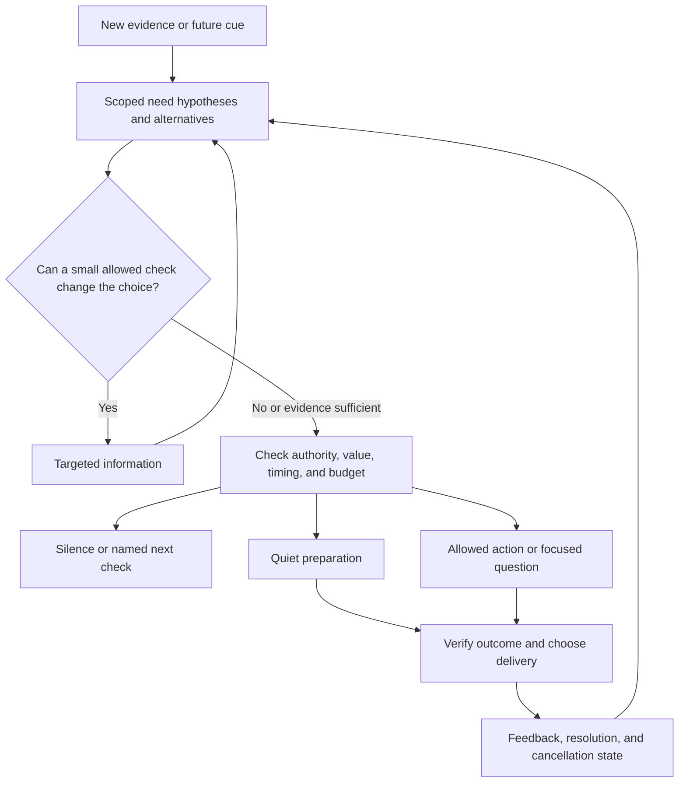

# Proactive Mike: science, need discovery, and evaluation

Research only. Evidence cutoff: **25 October 2026**. Assigned output: **docs/research/proactive-v2/02-science-and-evaluation.md**.

## Main finding and review of the earlier report

The earlier report gives Mike an important execution base: durable state, clear authority, cancellation, duplicate control, and proof of outcomes. Its first proposed capability, continuing explicit commitments, mostly answers **how to finish known work**. It does not fully answer **how to find useful work the user has not yet named**. Requiring every candidate to match an existing commitment would exclude that work by design.

Keep its separation between checking, working, and contacting the user. Keep its execution controls. Add a separate path for **need hypotheses**. A hypothesis can come from a new obstacle, a repeated difficulty, a change in available options, or a useful link between earlier context and a new situation. It must remain a hypothesis until evidence supports it. The source of relevance can be inferred; the authority to inspect or act must remain explicit.

My provisional recommendation is to test **bounded discovery in user-selected domains**, with cheap evidence checks, prospective cues, and separate work and delivery decisions. Do not make broad autonomous discovery a requirement for the first execution release. Do not postpone all discovery research until reminders and follow-through are complete: that would leave the central product question untested.

The strongest counterargument is that this adds a costly inference layer to a problem that simple event joins and a good user interface may already solve. Unstated needs are hard to label; plausible suggestions can create work and pressure to accept them. A matched comparison against a simple baseline could reject the recommendation. The rejection test is specified below.

## Scope and evidence rules

Read for this task: [AGENTS.md](../../../AGENTS.md), [PROGRESS.md](../../../PROGRESS.md), [architecture](../../ARCHITECTURE.md), [repo-structure-guard](../../../.agents/skills/repo-structure-guard/SKILL.md), and the [earlier research report](../proactive-mike-2026-10-25.md). Existing research findings were retained when this document was converted from Hebrew to English.

The main checkout was on branch claude/self-messages-floating-window-zl5arz at d91ab4105cc5b06fb72fc301b16797d042d25ec8, with existing changes. The earlier report reviewed a newer, separate worktree. These are different evidence surfaces. This study did not repeat that source audit or test the installed app. Old source does not override the latest trusted runtime snapshot.

No product code, other documents, memory, settings, or automations were changed. No installs, builds, Git writes, child agents, or personal phone-data collection were used. All scenarios below are proposed cases, not work performed on the user's devices.

Four evidence types stay separate:

- **Theory or architecture:** a proposed mechanism, without measured user benefit.
- **Offline evaluation:** recorded or constructed inputs; a model judge or deterministic scorer grades outputs.
- **Simulation:** a generated user or environment reacts to the policy.
- **Human intervention study:** people experience an intervention. Retrospective ratings of recorded assistance are weaker evidence than a long field trial.

Real human data does not make the evaluation a human intervention trial. A human check of judge labels does not measure long-term user benefit. A passed tool call does not prove that a proposed need was real.

## Findings at a glance

| Question | Primary evidence | Finding and limit |
|---|---|---|
| Is task completion enough? | [π-Bench v3, 19 May 2026](https://arxiv.org/html/2605.14678v3) | It separates hidden-intent discovery from completion. A simulated user can later supply what the agent failed to discover. |
| Does recall imply acting at the right moment? | [TriggerBench v1, 22 June 2026](https://arxiv.org/html/2606.23459v1) | Explicit recall, spontaneous recall, overload resistance, and false alarms differ. |
| Can current context expose an old need? | [ProMemAgent v1, 19 October 2026](https://arxiv.org/html/2610.27400v1) | Prospective cues and links to later developments help in controlled tests; this is not a longitudinal human deployment. |
| Do more questions discover more preferences? | [ATRBench v3, 15 September 2026](https://arxiv.org/html/2605.28108v3) | Forced questioning still leaves a large oracle gap. Acquisition and later application need separate scores. |
| Is more information always useful? | [Value of Information v1, 10 January 2026](https://arxiv.org/html/2601.06407v1) | Its policy loses to No Question in some high-cost settings. Information gain alone is the wrong objective. |
| Can initiative hurt work? | [Precision Proactivity v3, 7 March 2026](https://arxiv.org/html/2505.10742v3) | Model-initiated task switching is associated with lower work quality; this is observational evidence with GPT-4o. |
| Can quiet preparation help? | [ProAct v2, 26 May 2026](https://arxiv.org/html/2605.25971v2) | Directed preparation helps simulated conversations, at a substantial compute cost. |
| Does finding more evidence ensure a better answer? | [Q&D v1, 29 September 2026](https://arxiv.org/html/2609.37236v1) | Coverage improves without a clear final-answer gain; stopping remains difficult. |
| Is one wake strategy best? | [PM-Bench v1, 14 July 2026](https://arxiv.org/html/2607.12385v1) | Ledger, heartbeat, and multi-agent support have different failure modes. It establishes no ideal check interval for Mike. |

## Methods and experiments

Each entry states what the method observes and stores, how it produces a candidate or query, and what starts another decision. “Not evaluated” is a limit, not an assumed success. Figures below are reported results, not predictions for Mike or a ranking of current models.

### 1. BDI: separate possible goals from adopted intentions

**Source:** Rao and Georgeff, ICMAS 1995, [BDI Agents: From Theory to Practice](https://cdn.aaai.org/ICMAS/1995/ICMAS95-042.pdf).

**Method.** An event queue updates beliefs. An option generator produces possible plans; deliberation chooses which become intentions. Plans have invocation conditions and preconditions. Execution and new events update state; satisfied or impossible intentions are dropped. This gives a useful distinction between “this might help” and “the system has committed to this.” Reconsideration is part of control, not a fresh unconstrained plan every cycle.

**Experiment and baseline.** This is a formal and implementation paper, illustrated with the OASIS air-traffic system. It is not a controlled trial of personal need discovery. No human sample or modern assistant baseline supports such a claim.

**Results and limits.** The paper connects theory to a practical interpreter while explicitly reducing the expressive power of the ideal logic. It does not provide an algorithm that discovers all useful desires. Mike would still need an evidence-based option generator and a policy for adopting, suspending, and dropping candidates.

### 2. Mixed initiative: act, ask, defer, or do nothing

**Source:** Horvitz, CHI 1999, [Principles of Mixed-Initiative User Interfaces](https://erichorvitz.com/chi99horvitz.pdf); [author's publication record](https://www.erichorvitz.com/uiact.htm).

**Method.** LookOut uses message content and attention context to infer whether calendar help is wanted. Its initial classifier used about 1,000 messages, balanced between relevant and irrelevant. It compares action and inaction using expected utility; dialogue can resolve uncertainty, and attention affects when help should occur. Recent interactions remain relevant working state.

**Experiment and baseline.** A design and system demonstration, not a randomized human trial showing an overall productivity gain. The message training set is not a sample of people receiving proactive interventions.

**Results and limits.** It supplies a clear decision model for uncertainty and interruption. It does not establish modern LLM accuracy, calibrated probabilities, or permission to act. Its strongest lesson is to compare help against useful alternatives, including delay and silence, with asymmetric costs for a wrong intervention.

### 3. Goal inference as inverse planning

**Source:** Baker, Saxe, and Tenenbaum, Cognition 2009, [author manuscript](https://web.mit.edu/9.s915/www/classes/cognition2009.pdf), [MIT record](https://dspace.mit.edu/entities/publication/2e23673d-f720-4720-98bc-6db894ba27e1).

**Method.** Infer goals from observed actions by reversing an approximately rational planner. Maintain alternative goals and priors about persistence, goal changes, or subgoals. Another observed action updates the inference. This is a mechanism for testing explanations of behavior, not merely labeling the latest action.

**Experiment and baseline.** Three maze-animation studies had 16, 16, and 23 participants. Models with different goal priors were compared with a simpler action heuristic. Measures included agreement with people's goal ratings and bootstrap cross-validation.

**Results and limits.** Goal-change models fit best in the first two studies; a subgoal model fit best in the third. That supports flexible goal representations in a narrow setting. It does not validate inferring a person's real wishes from phone activity. Missing beliefs, habits, third-party activity, and mistakes can make the same behavior fit several goals.

### 4. Active preference learning

**Source:** Sadigh et al., RSS 2017, [Active Preference-Based Learning of Reward Functions](https://www.roboticsproceedings.org/rss13/p53.pdf).

**Method.** Store a distribution over reward weights. Generate two feasible trajectories whose comparison is expected to remove much uncertainty; update the weights from the user's preference. A reply starts the next query. This selects informative comparisons instead of asking broad profile questions.

**Experiment and baseline.** Driving simulations compared active synthesis with non-active and non-synthesis approaches. A separate usability study had 10 licensed drivers, ten learning queries per person, and ratings of learned versus perturbed rewards across ten test scenes.

**Results and limits.** Active synthesis learned faster in the simulation. Learned behavior received higher ratings than perturbed alternatives; the perturbation effect had p < .0001. The human study did not directly compare all query-selection algorithms. Simple hand-chosen features produced similar preferences across users. Uncertainty reduction is not automatically worth a real interruption, and these results do not establish a personal-assistant question budget.

### 5. Attelia II: detect a better moment to interrupt

**Source:** Okoshi et al., UbiComp 2015, [Reducing Users' Perceived Mental Effort](https://www.julian-ramos.com/papers/Okoshi2015a.pdf).

**Method.** Phone and watch UI/activity signals feed breakpoint detectors. Learned classifiers and device-use state determine whether to release a deferred notification and on which device. UI detection uses short windows; activity changes add opportunities when a device is carried rather than actively used. User labels support detector training.

**Experiment and baseline.** A month-long field study with 41 participants compared variants of breakpoint timing and random delivery. Measures included perceived workload using NASA-TLX.

**Results and limits.** Adding physical-activity breakpoints yielded a 71.8% greater reduction in perceived workload than the earlier UI-only system; watch delivery reduced workload by 19.4% against random timing. These are particular comparisons, not percentage-point gains in task completion. This work schedules existing notifications; it does not discover whether their content is needed. A breakpoint indicates a possible opening, not consent to start a new topic.

### 6. HeartSteps: measure actual effects and fading benefit

**Source:** Klasnja et al., published 2019, [Efficacy of Contextually Tailored Suggestions for Physical Activity](https://pmc.ncbi.nlm.nih.gov/articles/PMC6401341/).

**Method.** Context such as location, weather, and activity shapes suggestions. Eligible decision points randomize a suggestion or no suggestion. Delivery and subsequent activity are recorded. The design tests the value of intervention at an opportunity, rather than treating a click as success.

**Experiment and baseline.** Six weeks; 44 enrolled adults, 37 completed. Up to five user-selected decision points per day; the key comparison was suggestion versus no suggestion. The proximal outcome was steps in the next 30 minutes.

**Results and limits.** Overall suggestions added 14% or 35 steps on average, p = .06. Walking suggestions added 24% or 59 steps, p = .02; anti-sedentary suggestions had no detectable effect on that outcome. Effects declined over time; participants reported boredom after two to four weeks. This is neither proof of overall health improvement nor a recommended notification rate for Mike. It shows why repeated usefulness and habituation must be measured.

### 7. Proactive Agent and its ProactiveBench

**Source:** Lu et al., [v3, 3 December 2024](https://arxiv.org/html/2410.12361v3), published at ICLR 2025.

**Method.** Activity traces become events. A model predicts a potential task; accept/reject feedback updates the interaction. Human labels train a reward model that later judges proposals. Simulated activities expand the training set.

**Experiment and baseline.** 6,790 training events and 233 evaluation events. Separately, 1,760 human-labeled entries train/test the reward model, with 120 held out. Baselines include GPT-4o, Claude 3/3.5, and untuned open models.

**Results and limits.** Tuned Qwen2-7B reaches F1 66.47%, precision 49.78%, and recall 100% on the agent test. This is not the reward model's 91.80% F1. The learned judge is part of the measurement, not independent proof of user benefit. High recall coexists with many unwanted proposals. These are old model versions, not evidence of the current Codex model's behavior.

### 8. FingerTip 20K: prediction and execution are different tasks

**Source:** [v2, 16 March 2026](https://arxiv.org/html/2507.21071v2), ICLR 2026; [official repository](https://github.com/tsinghua-fib-lab/FingerTip-20K).

**Method.** Predict intent from profile, time, location category, up to 20 earlier intents, and partial screenshots. A separate track executes a known intent using earlier action demonstrations. A newly observed episode supplies another prediction point; persistent autonomous wake selection is not the tested capability.

**Experiment and baseline.** 95 Android data collectors recorded daily-life demonstrations for a month, producing over 20,000 episodes. General multimodal models and GUI agents were compared. Twenty other human annotators assessed 400 episodes.

**Results and limits.** On intent prediction, Qwen-QVQ-Max scored 12.8% success, GPT-4.1 7.2%, and humans 30.3%. The benchmark tests matching an observed intent, not whether unsolicited help improves life. Low human performance also signals ambiguity. Demonstration similarity is not necessarily user value. Its execution and suggestion results must not be combined into one proactivity score.

### 9. ProAgentBench: real traces, but need labels are still a proxy

**Source:** Tang et al., [v2, 9 February 2026](https://arxiv.org/html/2602.04482v2).

**Method.** Screenshots and application changes form events. Recent history feeds “when to assist”; a second stage predicts content. Retrieval, graph, and persona memory variants add longer history. Events, rather than an unrestricted continuous reasoning loop, are the decision units.

**Experiment and baseline.** Over 28,000 events from over 500 hours. Temporal/user-aware splits and contextually similar negative moments compare zero-shot, CoT, and self-consistency. Annotation uses a VLM; observed LLM use helps identify assistance moments.

**Results and limits.** DeepSeek-V3.2 zero-shot timing accuracy is 64.4%; Qwen3-VL-Plus zero-shot intention accuracy is 37.1%. CoT can hurt, including Qwen3-VL-8B timing F1 falling from 66.1% to 22.4%. Seeking an LLM is not the same as every useful help opportunity; non-use is not proof of no need. Participant count is not clearly specified in the inspected setup. No broad online intervention trial is shown.

### 10. ProAgent: sensing on demand and scoped feedback

**Source:** Yang et al., [v2, 7 May 2026](https://arxiv.org/html/2512.06721v2), the sensory-context system, not the Overcooked agent of the same name.

**Method.** Low-cost motion/location/audio cues trigger richer sensing. Recent context and scenario-grouped personas feed a reasoner and delivery controls. Verbal feedback plus its context updates personas; similarity/conflict handling merges or replaces entries. Suppression intervals stop a cheap cue repeatedly restarting rich sampling.

**Experiment and baseline.** CAB-Lite has 300 examples with a 60/40 train/test split. A separate collection and rating study used the same 20 participants. Baselines include reactive-agent adaptations and sensing strategies.

**Results and limits.** The paper reports up to 27.7% higher proactive prediction accuracy, and feedback-derived personas reduce false detection by 5.8% in its comparison. Seventeen of twenty participants reported satisfaction/willingness to use it. Ratings of assistance from captured contexts do not establish months of unobtrusive use. Glasses, server inference, and continuous sensory access differ greatly from Mike. Replacing a preference on semantic conflict needs stronger user control.

### 11. TriggerBench: remembering a fact is easier than noticing its use

**Source:** Zhang et al., [v1, 22 June 2026](https://arxiv.org/html/2606.23459v1).

**Method.** Earlier constraints meet later triggers, with matched positive, negative, overloaded, and explicit recall conditions. State is held in context or external memory. The later turn triggers evaluation; there is no autonomous wall-clock scheduler.

**Experiment and baseline.** 1,265 prospective-memory tasks from 488 blueprints, plus 440 retrospective probes. Compare long context, RAG, A-MEM, Mem0, and a simplified Letta-Sim. Rule-based slot matching complements GPT-4o judging; expert checks validate a sample, not user benefit.

**Results and limits.** GPT-5.2 high reasoning scores 98.16% on clean positives but 43.94% on clean negatives. GPT-4.1 overall falls from 60.00% at base length to 45.22% at 40K. Recall can improve while false alarms worsen. English-only, largely constructed text and simplified memory implementations limit transfer. Letta-Sim is not a full deployed Letta system.

### 12. PM-Bench: self-selected checks can beat more monitoring

**Source:** Liu and Gabriel, [v1, 14 July 2026](https://arxiv.org/html/2607.12385v1).

**Method.** A synthetic week has ongoing activity, delayed tasks, cancellations, rescheduling, and hidden channels that require queries. Compare a plain agent, a todo ledger, optional heartbeat, fixed heartbeat, and hierarchical agents.

**Experiment and baseline.** Eight models; 80 steps, 83 task definitions, 81 executable tasks, and 11 updates. Deterministic action-set scoring separates hits, false positives, stale updates, and query cost. No human intervention experiment.

**Results and limits.** Table 2 gives macro Set-F1 60.0% for the baseline, 62.8% for ledger, and 65.1% for optional heartbeat. Fixed 30-minute checks yield 57.8% with 489 false positives versus ledger's 134, aggregated across models. Table 3 gives GPT-5.4 optional heartbeat 79.1%. The abstract's wording associates 65.1% with a GPT-5.4 agent; do not repeat that as the per-model result. One constructed week and virtual minutes do not determine Android check frequency.

### 13. ProMemAgent: prospective cues and resolution links

**Source:** Xu et al., [v1, 19 October 2026](https://arxiv.org/html/2610.27400v1).

**Method.** Store timestamped facts, future event/time cues, and later resolution links. Current context retrieves cue matches and developments before deciding whether to help. Cues retrieve evidence; they do not authorize action.

**Experiment and baseline.** CPMBench: 1,000 instances from 250 scenarios, 200 events each; Omni adds sensory material to 500 instances. Compare full-context GPT-5.4, embedding retrieval, temporal memory, and immediate-help agents. Construction combines human seeds and verified LLM expansion; assistance is model-judged.

**Results and limits.** Set-F1 is 75.2% on text and 65.5% on Omni. Removing cues lowers text Set-F1 to 32.3%; removing development links raises false detection from 4.3% to 14.7%. This is controlled evidence, not a user field trial.

### 14. ATRBench: learn what the user has never told you

**Source:** Wu et al., [Ask Now, Use Later, v3, 15 September 2026](https://arxiv.org/html/2605.28108v3).

**Method.** During learning sessions, an agent may ask about reusable standing preferences that the current task does not require. Later offline-user tasks test their use. Store acquired answers separately from task context. A new interaction creates an acquisition opportunity, not an instruction to ask every time.

**Experiment and baseline.** Twenty synthetic personas, 284 rules, 568 learning sessions, six domains, 74 tools, eight agent models. Compare defaults, ATR prompting, always-ask, and an oracle given the preference. Shared simulator, router, and classifier affect measurement.

**Results and limits.** Default future-task accuracy ranges 15.0–23.7%, versus 82.5–96.7% with oracle information. Always-ask improves acquisition coverage but precision stays low. This isolates missing information, not just bad recall. Fixed hidden rules and designed future tasks exaggerate predictability compared with life; no human longitudinal trial. Asking more often cannot be treated as success.

### 15. Value of information: select useful uncertainty to resolve

**Source:** [v1, 10 January 2026](https://arxiv.org/html/2601.06407v1), [ACL 2026 paper](https://aclanthology.org/2026.acl-long.1987.pdf).

**Method.** Maintain beliefs over latent intent. Generate targeted questions, sample possible answers, estimate the best action after each answer, and ask only when expected downstream improvement exceeds communication cost. Stop when no query has positive value or the budget is exhausted.

**Experiment and baseline.** Three task families: mixed-stakes 20 Questions, flight preferences, and ambiguous WebShop. Compare no question, fixed rounds, adaptive prompting, and tuned confidence thresholds. This is controlled task evaluation; WebShop uses a model scorer. It is not a human interruption trial.

**Results and limits.** In Table 1's Gemini-2.5-Flash condition, VoI beats the best baseline by 1.36 utility at cost .05, but loses by .90 at .10 and .96 at .20. Estimated beliefs, answer models, utilities, and costs remain assumptions. “Parameter-free” does not mean free of modeling choices or universally superior.

### 16. Q&D: learn the content of initiative, and test stopping separately

**Source:** Levy et al., [v1, 29 September 2026](https://arxiv.org/html/2609.37236v1).

**Method.** A questioner chooses retrieval questions; a drafter maintains evidence. Training ranks question continuations by required evidence recovered, with separate stop contrasts. Need graphs come from benchmark decompositions, not a model judge.

**Experiment and baseline.** Qwen3-8B questioner; 200 held-out tasks in each of MuSiQue, StrategyQA, and 2WikiMultiHopQA. Compare the same prompted model, larger models, and structured retrieval at matched calls. Simulated customer-service transfer is separate from QA.

**Results and limits.** Equal-spend evidence coverage improves by about 11.2, 7.0, and 5.0 points over the same model. Final-answer gains are not clearly established. Only 20 of 1,040 tested prerequisite edges truly gate retrieval: depth often measures the decomposition, not discovery of previously unreachable needs. Stopping remains weak; declared checkpoint-selection criteria were not all met. This is useful evidence for candidate quality, not general autonomous life planning.

### 17. ProAct: prepare evidence between interactions

**Source:** Hu et al., [v2, 26 May 2026](https://arxiv.org/html/2605.25971v2).

**Method.** Conversations update profiles, facts, summaries, and artifacts. During idle intervals, predict future needs, select acquisition plans, and choose immediate, queued, or silent delivery. Predictions carry grounding and are revisited as dialogue and memory change.

**Experiment and baseline.** ProActEval has 200 constructed scenarios across 40 domains. Compare reactive, undirected idle search, and directed preparation. A GPT-4o simulator and GPT-4o-mini coverage judge use hidden need chains.

**Results and limits.** Required-turn measure T100 falls from 8.110 to 6.910; user-question turns fall from 9.140 to 8.075. Directed preparation adds about 111.8K active tokens per scenario in the reported accounting, excluding simulator, reactive, and judge tokens. The simulator skips future needs already covered, so reduced effort partly follows the evaluation design. It does not prove people want the same material or that quiet preparation is cheap.

### 18. PPP/UserVille: train communication without losing task quality

**Source:** Sun et al., [v2, 23 August 2026](https://arxiv.org/html/2511.02208v2), COLM 2026.

**Method.** GRPO training combines task reward, question effort, and preference adherence in a user simulator. Dialogue and replies update the immediate plan. This teaches interaction during a task; it does not evaluate independent background wake-ups.

**Experiment and baseline.** Seed-OSS-36B; SWE function localization and BrowseComp-Plus; task-only and reward-ablation baselines. A separate Prolific study reports 33 participants and 300 task evaluations; these are not 300 independent people.

The stated one-task/model assignment per participant does not clearly explain the reported 300 evaluations. Allocation needs clarification before interpreting uncertainty.

**Results and limits.** Simulated SWE localization productivity rises from 38.59 to 56.26; proactivity from 43.70 to 75.55. Human overall ratings are 3.75 versus base 3.45 and GPT-5 3.79. Feedback includes generic/excessive questions and loops. Full SWE with precise prompts slightly worsens, about .558 to .530. The personalization metric is conditional on asking, so it must be read with ask rate. Simulation gains do not remove user burden.

### 19. π-Bench: discovery can differ from completion

**Source:** Zhang et al., [v3, 19 May 2026](https://arxiv.org/html/2605.14678v3).

**Method.** Persistent workspaces and session history support hidden requirements and cross-session dependencies. The agent can elicit or resolve intents before the simulated user reveals them. PROC measures that initiative; COMP checks resulting requirements using programs or rubrics.

**Experiment and baseline.** One 20-session episode for each of five synthetic personas: 100 tasks. Nine models share a scaffold, with three repeats; GPT-5.4 simulates users and performs rubric grading. Model comparisons are not an ablation proving the best discovery architecture.

**Results and limits.** Reported PROC spans 43.1–67.0 and COMP 52.1–67.6. Rankings differ. Repeated runs do not create more independent personas. Each session still begins with a user request, so this mostly tests discovering requirements within work, rather than starting a new need from life context. Shared simulator/judge models and small domain coverage limit transfer.

### 20. Precision Proactivity: plausible help can create cognitive cost

**Source:** Lepine et al., [v3, 7 March 2026](https://arxiv.org/html/2505.10742v3). Earlier versions had the title Evaluations at Work; use the revised version's method and counts.

**Method.** Decompose a valuation task and map transcript content to subtasks and a knowledge graph. Estimate intrinsic/extraneous load, generated-content use, and model-initiated switching. Mixed-effects models relate them to graded work quality.

**Experiment and baseline.** Thirty-eight recruited professionals, 34 retained; load models use 1,178 participant–subtask observations from 33 participants. Compare regression specifications and within-task associations, not randomized proactive versus reactive assistants. The system was GPT-4o.

**Results and limits.** In Table 1, standardized extraneous-load association is about −.485, versus −.149 for intrinsic load; model-initiated switching is the strongest negative behavioral predictor. These are associations, not causal effect estimates or universal ratios. Transcript-based load is a proxy with missingness and modeling choices. Acceptance under load should not be treated as proof that an intervention helped.

### 21. Spotlights: discover new work inside an approved objective

**Source:** Barzelay et al., [v1, 17 September 2026](https://arxiv.org/html/2609.20446v1).

**Method.** Map repository modules, propose candidate source regions, review/revise them, and optionally attach technical research. State includes objective, scope, candidate locations, and evidence. Reviews can expand the candidate set; they do not infer an unrestricted new user objective.

**Experiment and baseline.** Case studies cover serving, retrieval, fault tolerance, and OCR. Expert reference locations test recovery; judges score candidate quality. A separate OCR implementation is timed against the original. This is not a personal-assistant user trial.

**Results and limits.** Fabric-X returns 119 candidates: judged precision is .70 at ten and .45 at twenty. The llm-d run recovers five of seven reference targets; a vLLM target ranks 57. Finding an opportunity and ranking it within a review budget are different. Sparse references cannot measure all missed needs; judge ratings do not prove actual defects. This is a useful model for bounded discovery, not proof of open-ended goal inference.

## What these studies do and do not establish

These papers support separating six mechanisms: generating options, testing intent, recalling future cues, choosing information, controlling delivery, and updating from feedback. No inspected study establishes their combined value in a general Android–computer assistant over months.

Several negative findings matter directly:

- More reasoning, more questions, more checks, and more agents can each make some results worse.
- A long context window can preserve a fact without making the agent notice its relevance.
- Matching observed behavior is not the same as knowing whether help was wanted.
- Preference elicitation, preference recall, and applying a preference can fail separately.
- A better discovery score can coexist with unchanged final answers or greater human effort.
- Repeated interventions can lose value. Early enthusiasm is not a stable preference.

Do not merge similarly named resources. Lu's ProactiveBench is not the visual-intervention ProactiveBench mentioned in the earlier report. ProAgentBench is a separate real-workflow benchmark. Sensory ProAgent is not the AAAI Overcooked ProAgent. ProActEval is not ProactiveEval. PM-Bench, TriggerBench, and CPMBench test different prospective-memory problems. Their F1, intent-match, timing, and usefulness scores have different denominators.

The available evidence justifies experiments with a mechanism, not carrying old model percentages into a 2026 Mike release.

## Alternative routes for Mike

There is no single result here that forces one architecture. These routes answer different product questions.

| Route | What it can discover | Benefit | Cost or failure risk | Test that could reject it |
|---|---|---|---|---|
| A. Commitments plus simple event joins | Known work and obvious related events | Clear authority; small state; low cost | Misses needs without a task record | Independently labeled new needs remain missed despite sufficient authorized evidence |
| B. Bounded discovery by domain | New obstacles and opportunities in selected areas, without a task instruction for each one | Tests the user's actual request for initiative | Hypothesis errors, extra sensing, review burden | No meaningful extra benefit over A at matched cost and contact limits |
| C. Quiet preparation first | Likely future evidence or drafts, surfaced when relevant | Can help without an interruption | Waste, stale material, and preparation the user never wants | Prepared work is rarely used or saves less effort than it costs |
| D. Preference questions at natural openings | Missing reusable preferences, then better future choices | Makes uncertainty explicit; user can steer | Repeated questions, cold-start burden, weak future payoff | Acquisition fails to improve later decisions after counting question effort |
| E. Broad context-driven assistant | Needs across many activities and devices | Largest possible discovery space | Weak evidence, privacy cost, difficult attribution and scope control | Narrow policies achieve the same benefit with lower burden |

**Recommendation:** compare A against a limited B, with C and D as separately switchable parts. Keep E as a research direction. A is a reasonable release path for execution reliability; it is an insufficient definition of the user's desired end state.

The important choice is not “explicit goals or unrestricted surveillance.” A user can choose a standing area of help, allowed sources, and allowed preparation. Mike can discover specific needs within it without asking the user to write a task for every opportunity.

## A concrete reference policy

Everything in this section is a proposed policy. It was not implemented or tested in this task.

### State: evidence, hypotheses, preferences, authority, and outcomes

Use small structured records before assuming a large knowledge graph is necessary.

| State | Required content | Why it matters |
|---|---|---|
| Observations | Source, subject, observation time, receipt time, allowed use, freshness, uncertainty, source version | A stale or third-party fact must not become the user's present intention |
| Need hypotheses | Proposed need, supporting and opposing evidence, alternative explanations, domain, useful action window, status | A plausible story is not a fact or an instruction |
| Future cues | Event/time predicates, evidence they retrieve, expiry, matching limits | Earlier facts can become useful in a different context |
| Preference state | Exact explicit statement or inferred rule, context, feedback source, confidence limits, update history | “Not while riding” must not become “never tell me about this” |
| Authority | Separate read, preparation, control, and external-action scope; version, expiry, revocation | A need score cannot grant access or permission |
| Work and delivery | Attempt ID, claim owner, result evidence, unknown outcomes, contact history | Finishing work and telling the user are different |
| Check state | Next event/time, expected decision-changing fact, expected value, budget, last evidence version | A loop must explain why another check can help |
| Suppression state | Resolved/cancelled candidate IDs, reason, scope, duration, authority version | Repeated inference must not resurrect cancelled work |

A source can say “the appointment changed,” but it cannot grant new authority or instruct Mike to ignore the user. A quoted message about somebody else's plan is not evidence that the phone owner has that plan.

### Generate candidates beyond commitments

Run a bounded candidate pass after meaningful new evidence, not after every raw event. Start with cheap typed signals and source changes. Candidate families should include:

1. **Obstacle:** repeated failure or a missing prerequisite suggests a new support task.
2. **Conflict:** two currently relevant facts cannot both fit, such as an arrival window and a calendar item.
3. **Opportunity:** a previously useful option becomes available, cheaper in effort, or easier to complete.
4. **Cross-context link:** an old unresolved observation becomes actionable in a new setting.
5. **Repeated friction:** the same avoidable effort appears across separate interactions.
6. **Information gap:** a missing fact could change an important choice or repeatedly block later work.
7. **Capability change:** a new authorized tool or data source makes previously impossible help feasible.

These are generators, not sufficient reasons to intervene. For each candidate require:

- The evidence that produced it, and the likely user benefit.
- At least one credible alternative: no need, already handled, wrong subject, temporary situation, or preference mismatch.
- A bounded next step that can disprove the hypothesis.
- A useful window and expiry condition.
- The minimum extra information needed and its allowed source.
- A duplicate key and a link to any previous rejection or resolution.

Do not let the generator define success as “user accepted my suggestion.” Require a concrete change such as avoiding a conflict, producing material later used, reducing repeated effort, or finding an option the user values. Reject candidates that merely restate generic advice.

For example, “the user often asks how to export this data” can create a hypothesis about a missing reusable export path. It need not match an open export task. But one accidental tap, a completed export, or a statement about a different person should weaken that hypothesis.

### Select information by decision value

Maintain several explanations rather than one confident narrative. For a possible observation or question q, use the following conceptual comparison:

    value(q) =
        expected value of the best allowed choice after q
        minus value of the best allowed choice now
        minus collection, computation, privacy, and interruption costs

The comparison must include waiting and doing nothing. Reducing uncertainty is useful only if it can change the choice. For example, learning a preference about document style has little value if both possible answers lead to the same prepared summary.

Use a staged sensing plan:

| Level | Example | Escalation condition |
|---|---|---|
| 0. Already held state | Recent conversation fact, task result, approved source version | A new combination suggests a testable need |
| 1. Narrow metadata | Changed status, timestamp, availability field | The answer could distinguish competing explanations |
| 2. Targeted read | One calendar event, one connected-app query, one relevant file section | Existing authority covers that source and the expected decision benefit is positive |
| 3. Focused interaction | A specific user question or visible screen inspection | Cheaper sources cannot answer; the needed access and attention cost are justified |
| 4. New source or richer sensing | Additional app capability, location, microphone, camera | User chooses this expansion; the specific missing decision is clear |

A capability being available is not proof that continuous use is allowed. Do not start broad screen logging because a single status field is missing. Stop the sensing chain when the answer would no longer change the action, the evidence is sufficient, authority ends, or the expected gain falls below cost.

A model's verbal confidence is not a calibrated probability. Initially use evidence classes and held-out measured error rates, show uncertainty, and compare conservative bounds. If a utility score depends on invented confidence or unknown user costs, treat it as a ranking aid for review, not as an automatic execution rule.

### Plan over a horizon without inventing an endless mission

Prospective memory retrieves an intention at a useful moment; it does not by itself construct or revise a plan. For a selected candidate, store a small plan with prerequisites, expected observations, useful deadlines, verification steps, and exit conditions. Split uncertain later work into branches instead of committing to a long fixed action list.

Use a rolling horizon: choose the next useful reversible step, retain later options, and reconsider when a result, source change, cancellation, or new constraint changes the choice. For example, discovering a possible export problem can justify checking the supported format before planning a converter. A failed format hypothesis should end that branch, not create a chain of increasingly broad investigations.

Keep the value of the remaining plan separate from the sunk cost of earlier preparation. Stop when the useful window closes, a prerequisite cannot be obtained within scope, the expected remaining benefit is too small, or the user resolves the need. An unfinished plan is not evidence that continued work is worthwhile.

This is also the limit on self-generated subgoals: each must explain its link to the selected benefit and inherit the same source, authority, and resource limits. They cannot expand the original scope by recursive decomposition. Replanning should be triggered by decision-changing evidence, not by a fixed demand to keep thinking.

### Separate preparation from contact

For each surviving candidate compare:

- Discard it with a reason.
- Wait for a named event or better evidence.
- Prepare a small, useful artifact within existing authority.
- Save it for the next relevant conversation or a user-chosen review.
- Ask one focused question.
- Perform an action already covered by current authority.

Only then choose a delivery channel and time. Preparation can be useful even when contact is wrong. Conversely, completing a background check does not create a reason to announce it.

Prefer a short explanation grounded in evidence: “The new time overlaps your other event; I found two options.” Avoid claiming an inferred goal as certain. Group related candidates. A single user decision should not produce separate alerts from the phone, Pc, and Server.

### Pick the next check instead of a fixed thinking rate

Every next-check decision must identify **what could change** and **why knowing it then would matter**.

Store one of:

- **ON_EVENT:** a particular source change, result, or cue predicate.
- **AT_TIME:** a meaningful boundary such as the last useful preparation time, source publication window, or an explicitly requested deadline.
- **ON_USER_RETURN:** only reconsider when the user returns to the topic or chooses a review.
- **NONE:** no useful future check is currently justified.

For AT_TIME, estimate the tradeoff between the chance of a decision-changing update, the cost of discovering it later, and the cost of another wake and query. Select a feasible check near the next change in that tradeoff. Do not invent a precise hazard model when there are too few observations; use known source times or bounded backoff.

An event-based check needs a fallback only where a missed event has material cost and a bounded check can detect it. Polling without a known event contract must be counted as polling. Merge related checks and let the platform batch them where delay is acceptable.

Advance a check after a relevant change, approaching deadline, or increased consequence of delay. Push it back after repeated unchanged results, unavailable devices, low battery, expensive requests, or loss of relevance. A repeated empty result must not call the full model merely to decide the same thing again.

Candidate expiry and preference revocation outrank a scheduled wake. An external event may invalidate an earlier plan. Lack of a response is not approval. A cancelled hypothesis receives a retained suppression record; a generator cannot bypass it by rewording the same task.

The operating system decides when background work actually runs. Logical next-check time is not a promise of precise delivery. The [Android work-request documentation](https://developer.android.com/develop/background-work/background-tasks/persistent/getting-started/define-work) describes periodic work's minimum interval and constraint-dependent timing. A scheduler delay must be visible in evaluation; it must not be scored as bad intent inference.

### Learn preferences without treating silence as feedback

Record different answers separately:

| Feedback | Update |
|---|---|
| Useful, right moment | Evidence for this content and context; no new action authority |
| Useful, wrong moment | Update delivery policy while retaining evidence of need |
| Not for me | Reduce relevance for the stated scope; seek the reason only when useful |
| Already done | Resolve this instance; check whether the completion source was missing |
| Not now | Defer with the user's time/context limit |
| Never suggest this | Suppress the stated class until the user changes that instruction |
| Stop monitoring this source | Revoke that source use and dependent pending checks |
| No response | Missing feedback; do not label it as acceptance or dislike |

Keep explicit instructions above inferred preferences. Store context and counterevidence instead of turning one rejection into a permanent personality trait. Decay or revalidate uncertain inferred preferences when context changes; do not silently expire a clear prohibition.

Later outcomes matter. If a prepared artifact is used next week, credit the preparation policy then. If the user accepts a suggestion but spends time correcting it, record that cost. Separate curiosity clicks from useful outcomes. Avoid learning only from accepted proposals: the policy itself determines which examples the user sees.

For early deployment, an auditable table of scoped rules and evidence may be better than learned policy weights. A contextual bandit is a possible later experiment only after logging action probabilities, delayed reward, drift, and hard exclusions. Do not explore by sending messages, spending money, or doing other consequential actions merely to learn whether the user likes them.

### Decide to remain silent

Silence is the selected outcome when:

- Evidence does not distinguish a real need from plausible alternatives.
- The matter was handled, cancelled, declined for this scope, or has expired.
- A proposal repeats information the user already has without adding useful action.
- The user cannot use the information before it expires, or the timing cost is too high.
- The best extra query would cost more than it could change.
- Authority or a required source is missing; the low-value candidate does not justify asking for more access.
- Preparation would likely be discarded or become stale.
- Another active task owns the needed screen or attention.
- The remaining budget is better spent on higher-value work.

Record a compact reason and any legitimate reactivation condition. Silence must not hide execution failures, a result the user explicitly asked to receive, or required approval status. Those belong to separate delivery contracts.

## Fit with Android, Pc, Server, conversations, and connected apps

This is a proposed division of responsibilities, based on the inspected documentation and current tool contracts, not a verified running architecture.

| Surface | Useful role | Boundary and evidence gap |
|---|---|---|
| Android | Local authority, delivery, context explicitly made available, visible device actions, Stop | Background limits and screen ownership apply. Rich sensing requires its own scope |
| Pc | Bounded file/repository analysis and preparation in approved locations | SSH availability does not establish a live desktop session, current project scope, or permission for broad file inspection |
| Server | Longer preparation or remote-source checks where chosen | “Connected” does not prove continuous availability or reliable event receipt |
| Conversations | Facts, repeated friction, open questions, preferences, and their source wording | An idea, quotation, or past wish is not automatically a current goal |
| Mike Connect | Small, typed reads and verified actions exposed by each app | App names do not establish telemetry fields, subscriptions, background access, or automatic execution grants |
| Workflows/tools | Reuse an already understood sequence with verification | Known execution paths do not decide whether a new need is worth pursuing |

The current runtime lists Ghostride and LumaStand as connected. This research did not query their user data. A future evaluation must inspect their schemas and grants before designing real signals. If the contract offers list/describe/call but no subscription, an assumed push stream is a design error; use authorized bounded checks or add an explicit event contract in a separate task.

Relevant source-document boundaries include AgentCoordinator, SessionRunQueue, DeviceToolGateway, CompositeDeviceToolGateway, KnowledgeStore, and AgentAccessibilityService. The inspected [architecture](../../ARCHITECTURE.md) states that outside active runs the accessibility service does not read event text or retain trees. Turning it into a passive behavior logger would be a product and privacy change, not a free research assumption. The newer runtime and the earlier report's DeviceLease discussion must be checked separately before implementation.

Phone actions should continue through the existing device gateway and Stop path. A cross-device candidate needs one claim owner and a current authority version. The phone controls contact and local screen use; a computer cannot infer permission from stale copied state. Preparation on Pc or Server can continue only within its granted scope, with a separate outcome from phone delivery.

Do not require Wireless ADB for capabilities already served by local tools or accessibility. Do not treat a build, transfer, install, source review, successful API response, or runtime task receipt as proof of successful proactive assistance. Installed behavior and long-term user value need their own tests.

## Six detailed scenarios and counterexamples

These are hypothetical test cases. They do not assert that Mike already has the required source, field, event, or permission. They deliberately include useful new work that is not a reminder or continuation of a named task.

### 1. Travel: discover a coordination problem

**Observation and candidate.** In a chosen travel-help domain, an authorized calendar update shows a meeting moved later; an earlier conversation mentions a planned train journey. No one requested travel monitoring for this particular conflict. Mike hypothesizes that a connection or pickup plan may no longer fit.

**Missing information.** The meeting may be remote, the old journey may have been cancelled, and the ticket may belong to someone else. First check the current versions of the two relevant records. Ask about attendance mode only if the answer changes the options; do not inspect every travel message.

**Action and timing.** If supported, prepare a small comparison of two feasible options. Surface it before the last useful decision time, when the user is available. Do not book, cancel, or message a driver without authority.

**Next check.** Watch a named meeting or itinerary change if supported; otherwise one bounded check at the useful boundary. Stop after the journey is resolved or its window ends.

**Feedback and cancellation.** “Remote meeting” removes this conflict. “I want travel help only for flights” narrows the domain. “Stop watching this trip” cancels dependent candidates and checks.

**Counterexample.** Two overlapping calendar items can be intentional. A train-station location alone does not show the user wants travel help.

**Scored outcome.** Did Mike identify a real coordination issue with evidence available then, reduce decision effort, and avoid an unwanted travel change?

### 2. Household shopping: connect an old fact with a new opening

**Observation and candidate.** A prior conversation contains “we ran out of oat milk,” without an instruction to create a shopping task. Later, an authorized shopping-list interaction makes that fact relevant. Mike hypothesizes that a short list addition would help.

**Missing information.** The household may already have bought milk; the remark may concern a different home. The shopping source may not expose a change stream. Check the current list or ask one narrow question within the selected household scope. Location is unnecessary if the list interaction supplies the opening.

**Action and timing.** Prepare a suggested addition, or add it only under an existing grant for that list. Group related suggestions at the shopping opening; do not send a separate alert just because the old fact was retrieved.

**Next check.** The next relevant list update or user return, not a recurring model call. Expire the candidate if the shopping episode ends and there is no remaining useful follow-up.

**Feedback and cancellation.** “My partner bought it” resolves the instance. “We switched to dairy milk” updates a scoped preference; it does not rewrite the original observation. “No household inference” ends the discovery scope.

**Counterexample.** A recipe mentioning milk is not evidence of a shortage. Visiting a shop is not permission to place an order.

**Scored outcome.** Useful list help versus duplicate purchases, correction effort, and unnecessary contact.

### 3. Software work: detect repeated friction across completed tasks

**Observation and candidate.** Across several authorized project conversations, release checks repeatedly require manual reconstruction of the same evidence. Each task finished; no one asked for a new tooling task. Mike hypothesizes a reusable evidence checklist or helper would reduce future work.

**Missing information.** The repetitions may be intentional review gates, may belong to different repositories, or may already have a solution on a newer branch. Inspect only the approved project references and current documentation needed to distinguish those explanations.

**Action and timing.** Prepare a short proposal with an actual example and estimated saved steps. Editing, building, installing, or changing CI requires suitable task authority. Present during the next relevant project discussion instead of interrupting unrelated work.

**Next check.** A new occurrence, a relevant tooling change, or user return. Do not rescan every repository on Pc or Server.

**Feedback and cancellation.** “These checks must stay manual” suppresses automation proposals for that gate, while allowing an evidence checklist if wanted. “Already fixed on dev” resolves the candidate pending a narrow verification. “Stop this idea” closes it.

**Counterexample.** Repeated commands can be deliberate safety checks. A dirty worktree is not itself a request to clean or repair it.

**Scored outcome.** New friction found and effort saved, separately from code correctness and execution proof.

### 4. Ghostride: distinguish a data problem from a health conclusion

**Observation and candidate.** If an approved capability exposes timestamped sync status, an unusual gap after previously regular uploads can suggest a sync or recording issue. The discovered need is help recovering data, not a medical conclusion or a new training goal.

**Missing information.** Rest, a disabled sensor, an app update, and a connection fault are competing explanations. Check minimal sync metadata and its freshness. The app being connected does not establish that these fields exist or that historical health data is available.

**Action and timing.** Prepare a plain explanation of what is missing and one low-risk recovery option. Keep it for a post-ride or app-review opening. Do not start voice contact during riding or infer illness from absent data.

**Next check.** A sync result, reconnection, or the next relevant app interaction. Back off if metadata does not change; stop if recording was intentionally disabled.

**Feedback and cancellation.** “Rest week” resolves this instance. “Tell me about sync problems, not training advice” defines a narrow preference. Revoking the source stops dependent checks.

**Counterexample.** Missing records are not evidence of a missed workout or poor health. A one-time time-zone change can mimic a gap.

**Scored outcome.** Correctly discovered data issues, false concern, timely quietness, source-query cost, and confirmed recovery.

### 5. LumaStand: discover a business pattern without inventing a problem

**Observation and candidate.** If authorized aggregate status data shows repeated failures in a workflow, Mike can hypothesize a shared cause that deserves a small investigation. This is new analysis, even if nobody created an incident.

**Missing information.** A denominator, normal seasonal pattern, maintenance window, version, and final outcomes may be missing. Read the smallest available aggregate that can distinguish an actual change from a few normal cases. Do not collect customer conversations merely because the app is connected.

**Action and timing.** Prepare a source-backed comparison and the uncertainty. Present at the next business review unless delay would have a clear cost. Do not change pricing, customer records, or send messages based on the hypothesis.

**Next check.** The next completed workflow cohort or a version/status change, with a bounded time fallback only if useful. Avoid announcing every additional instance of the same pattern.

**Feedback and cancellation.** “Expected during this rollout” changes the baseline and resolves false concern. “Only escalate confirmed repeated failures” narrows delivery. “Stop watching this process” removes the checks.

**Counterexample.** Three failures without the number of attempts cannot establish deterioration. A new version can change event definitions rather than user outcomes.

**Scored outcome.** Valid new patterns found, review burden, missing-data honesty, and avoided incorrect operational action.

### 6. Learning and family content: infer a useful format, not a new obligation

**Observation and candidate.** In a selected learning/content domain, repeated conversations show that short story-based examples help, while long exercises go unused. Mike hypothesizes that a small reusable story format would help the next session, without a request to produce it now.

**Missing information.** The earlier content may have been for a different child or a one-time event. Age, current topic, available time, and whether the format is still wanted can be unknown. Reuse only the stated context; do not gather family photos or infer personal attributes.

**Action and timing.** With a standing creative-preparation grant, prepare a short editable draft. Otherwise retain a bounded proposal. Offer it at the next learning conversation, without turning a family preference into a daily homework program.

**Next check.** User return or a new topic choice. No periodic wake is useful just to ask whether the user wants more content.

**Feedback and cancellation.** “That was for a birthday” resolves the mistaken generalization. “Only English stories, no exercises” narrows the format. “Stop making these” cancels queued drafts and later offers in that scope.

**Counterexample.** Repeated requests show past demand, not consent to create an ongoing schedule. A child not using a draft does not by itself identify a learning difficulty.

**Scored outcome.** Later use and reduced preparation effort, with correction burden and unwanted family inferences counted separately.

## Evaluation plan

The target is **useful new needs discovered with less net effort**, not the number of proactive messages. The following is a proposed evaluation program; none of it was run in this task.

### Define an opportunity before scoring the model

An opportunity is a decision point at which an allowed action, question, or preparation step could improve a user-valued outcome within a useful window, using evidence that could legitimately be available then.

Label each case with:

- Need category and subject; whether it is a new need, an explicit commitment, or an uncertain case.
- Evidence available at the decision time, including which sources are authorized and actually observable.
- Acceptable help options and unacceptable expansions.
- The useful time window and whether contact is necessary.
- Resolution, cancellation, and preference changes.
- Outcome evidence and remaining uncertainty.

Use at least three visibility labels: **detectable from available evidence**, **could be detected with an allowed targeted query**, and **not observable under the allowed sources**. Report all three. Do not punish a policy for refusing unauthorized sensing, or hide a coverage problem by excluding all unobservable needs.

A need can be real while the proposed action is bad. It can also be real but not important enough to justify contact. Labels must preserve those distinctions. Users should be able to say “uncertain,” “already handled,” or “there was no useful opening” instead of being forced into accept/reject.

### Four separate score groups

| Axis | Core measures | Failure that it exposes |
|---|---|---|
| Need detection | Precision and recall of distinct supported needs; PR curve at natural prevalence; novel-need yield; missed-opportunity reasons | Irrelevant proposals, invented needs, and systems that always stay silent |
| Action quality | User-valued result, correctness, useful artifact uptake, avoided effort minus correction effort, preference fit | Correct need with a poor or wasteful response |
| Timing and interruption | Within-window delivery, too early/late, duplicate contacts, unwanted contacts per user-day and per opportunity, interruption recovery time, deferral loss | Useful content arriving in a harmful way |
| Execution reliability | Verified outcome, duplicate side effects, unknown result rate, cancellation/revocation violations, delivery completion | A sound decision that never succeeds or repeats an action |

For detection, count both **candidate false positives** and **delivered false positives**. They have different costs. A discarded false candidate still costs computation or sensing; a wrong interruption also costs attention. If conventional FPR is reported, define the negative decision opportunities used in FP/(FP+TN); arbitrary quiet seconds are not a meaningful denominator.

Recall needs an independent opportunity set: TP/(TP+FN). Candidate generation failure must count as a miss, not vanish because the evaluator only saw candidates. Merge duplicate proposals for the same need before calculating recall or useful-need yield.

A joint outcome can be reported in addition: a supported need, useful action, acceptable time, and verified execution. Keep component scores so an improvement cannot hide a failure elsewhere. Do not multiply unrelated aggregate percentages and call the product end-to-end success.

If probability estimates are used, test calibration on held-out cases using reliability plots and a proper score such as Brier loss. Separate probability of a need, probability of useful action, and probability that this is a good time to contact. A balanced benchmark's precision does not directly predict precision in a low-prevalence live stream.

### Simple baselines that deserve to win

Run the same model, sources, authority, and budgets where possible:

| Baseline | Purpose |
|---|---|
| Always silent / reactive only | Measures cost saved by silence and the needs it misses |
| Explicit commitments plus deterministic triggers | Tests the earlier report's main path |
| Simple event joins, freshness checks, duplicate control, and cue rules | Tests whether an LLM adds value beyond straightforward logic |
| Fixed periodic check with the same total budget | Tests self-scheduling against a simple clock |
| Full model on every eligible event | Exposes compute waste and over-intervention |
| Current context only, without history | Tests whether long-term memory adds actual discovery value |
| Similarity retrieval without future cues | Tests prospective cue matching |
| Ask a generic preference question at each selected opening | Tests targeted information value against asking volume |
| Quiet preparation without immediate delivery | Separates preparation value from interruption policy |
| Oracle evidence or oracle timing, used only for diagnosis | Locates the bottleneck and bounds what the available sources can support |

Include ablations for resolution links, opposing explanations, scoped feedback, sensing escalation, and next-check choice. Keep candidate generation fixed when comparing delivery policies; keep delivery fixed when testing candidate quality. Also compare whole policies, because these parts can interact.

A baseline that helps more at the same burden and resource cost is a valid outcome, not a reason to add more components until the preferred design wins.

### Counterfactual replay: controlled tests with limits

Build paired traces with the same initial observations and alter one factor:

- The need exists and is still unresolved.
- It was resolved by a later event.
- The user cancelled or changed the preference.
- A similar cue occurs but the need never existed.
- The necessary fact is missing, stale, from a different subject, or outside scope.
- A device or source is unavailable, or the execution outcome is unknown.

Use the same input cutoff and model/harness versions. Hide later ground truth from the policy. Compare actions and check decisions at the same eligible points and resource budgets. For branching information collection, expose only the response that the chosen allowed query would return.

Measure evidence gathered per query, useful needs per compute budget, lead time, stale-action rate, and unnecessary checks. Include cases where the best choice is to stop searching. Score cancellation and identity confusion with deterministic assertions wherever possible.

Replay does **not** establish what a person would have done after a different interruption. A live action can change the later timeline; fixed logged traces cannot simulate that change honestly. Report branch-model assumptions. Use off-policy estimates only when action probabilities were logged and the new policy has adequate support in the old policy's actions. Importance weighting cannot recover outcomes for actions never taken. Do not present retrospective replay as a causal human trial.

### Shadow mode: test discovery without contact

Shadow mode should record what the policy would have proposed and why, using only the sources the user chose. It sends no proactive message and performs no candidate's external action. It is a proposed future experiment, not an automation activated here.

Sample decisions from both proposed and silent periods. Use random samples of ordinary time windows or workflow openings, plus user-reported needs and selected difficult cases. Keep sampling probabilities so rare-case enrichment does not distort prevalence estimates. The sampled opportunity pool should be created without reading only the generator's output.

Have the user and, where appropriate, independent reviewers label the evidence. Reviewers should first see only the information available then. A second pass can examine later outcomes. This reduces hindsight leakage while preserving eventual facts.

Shadow mode can estimate candidate relevance, source coverage, query cost, duplication, and missed observable needs. It cannot measure the actual interruption cost of an alert that was never delivered. Retrospective “I would have liked this” is useful feedback, not equivalent to demonstrated benefit.

Audit judge performance separately on positives, negatives, cancellations, and ambiguous cases. Use a model judge to assist scale, not as the sole source of ground truth. Blind policy names, randomize presentation order, retain disagreements, and report agreement/error by class. Shared generator/simulator/judge families can introduce correlated errors.

### Quiet-preparation and human timing studies

After shadow results are acceptable, separately test:

1. Whether prepared artifacts are later used and reduce total effort.
2. Whether presenting a candidate helps compared with deferring or silence.
3. Whether the proposed timing is better than a simple available opening.

For eligible, low-risk opportunities, a consented micro-randomized design can compare contact, deferral, and silence. Keep consequential actions and explicitly required alerts outside exploratory randomization. Measure proximal outcomes and delayed costs, including later correction and repeated-topic fatigue.

The unit of randomization may be an opportunity, but repeated observations from one person are not independent users. Analyze within-person and between-person effects, cluster uncertainty by user and day/workflow as needed, and account for carryover: yesterday's suggestion may change today's need. For Yoni alone, an N-of-1 crossover can inform his policy; it cannot establish population benefit.

Pre-register the primary outcome, availability rule, meaningful effect size, cost limits, stopping criteria, and analysis. Choose sample size from expected variance, clustering, and a meaningful effect, not a guessed target success rate. Run long enough to examine whether usefulness changes over repeated exposure. Report missing feedback, withdrawal, and source failures.

### Resource accounting: computation, sensing, attention, and battery

Every policy should have a full cost ledger:

| Cost | What to record |
|---|---|
| Model use | Input, output, cached tokens, calls, latency, model/version, and actual billed cost |
| Tools and sources | Query count, bytes, source latency, rate-limit failures, and repeated unchanged reads |
| Memory | Extraction/write cost, retrieval cost, retained volume, expiry work, and freshness loss |
| Android | Wakeups, wake-lock duration, CPU time, network/radio use, display/control time, sensor use, and measured incremental energy |
| Pc/Server | Process/GPU time where relevant, remote wake/availability, transfer cost, and failure recovery |
| Human attention | Reading, answering, deciding, task switching, correcting, dismissing, and managing the policy |

Allocate cost per candidate as well as per useful outcome. Also report total cost per user-day, including rejected candidates and days with no successful help. Amortize memory preparation only across actual later use; do not divide by an invented lifetime of future queries.

For battery, compare matched or randomized periods on the same device with workload, charging, radio, and screen conditions recorded. Battery percentage alone is too coarse and confounded to establish low overhead. Measure the incremental cost of each sensing level and whole-policy cost. Offloading to Server can reduce phone compute while increasing radio traffic and total cost.

Set separate user-selected limits for attention, model spending, sensing, and energy. A tiny token bill does not justify continuous location or screen access. Enforce backpressure and cancellation before another expensive check. Include the cost of collecting evaluation labels so an experiment does not hide its management burden.

### Reliability tests before a live pilot

The execution layer needs deterministic tests for duplicated/out-of-order events, source-version changes, clock and time-zone changes, expired authority, cancellation between planning and action, process restart, reboot, offline phone/computer, lost event receipt, and partial delivery.

For a possibly committed action with a lost reply, inspect current state using a stable request/attempt identity; do not replay blindly. “Queued,” “accepted,” “started,” “completed,” and “delivered” must have separate evidence. A successful proposal with an unknown execution outcome remains unknown.

These tests should distinguish inference mistakes from scheduler delay, source failure, tool failure, and human unavailability. A correct inference should not receive execution credit from a mere receipt. A successful tool action should not receive need-discovery credit when it solved the wrong problem.

### Pilot gates and a test that can reject the recommendation

Advance capabilities separately. Passing source or replay checks does not authorize a human pilot.

| Gate | Evidence required | Hold or stop condition |
|---|---|---|
| 1. Reproducible offline evaluation | Frozen model/harness/data, allowed-source labels, negative cases, simple baselines, error accounting | Leakage, unclear ground truth, or comparison budgets differ |
| 2. Shadow discovery | Independent silent-window samples; supported new needs found; resource ledger; scoped suppression works | Plausible but unsupported needs, missing cancellation handling, or costs exceed chosen limits |
| 3. Quiet preparation | Useful later artifacts, less total effort after waste/corrections, no authority expansion | Unused/stale work dominates or source access grows without demonstrated value |
| 4. Limited contact | Consented low-risk trial; useful outcomes and timing versus silence/deferral | Excess burden, repeated-topic fatigue, scope violation, or unreliable delivery |
| 5. Broader domain/action scope | Replication over new contexts and sustained use; reliable execution proof | Gain depends on one persona, source, or short novelty period |

Before the comparison, Yoni and the team should set a smallest worthwhile improvement **δ**, and maximum attention, money, sensing, and energy costs. These are product choices. No reviewed paper supplies their correct values for Mike.

**Primary falsifiable test:** compare A (commitments plus simple event joins) with B (bounded new-need discovery), using identical allowed sources, the same action envelope, and matched compute/contact budgets. Hold out later periods and independently label new needs, including silent periods. The primary outcome is user-valued new needs usefully served, after measured correction and attention cost; execution success is reported separately.

**Reject the added discovery layer** if the upper uncertainty bound on its benefit over A is below δ, or if it repeatedly violates the preselected burden/resource limits. A result spanning worthwhile gain and no gain is inconclusive: keep the simpler path while gathering better evidence. Any unauthorized sensing/action or cancelled work restarted by inference stops that pilot path until corrected; zero observed violations is not proof of zero risk.

Also reject specific components independently:

- Future cues fail if ordinary retrieval gets the same need recall at lower cost.
- Targeted questions fail if they do not improve later choices after question effort.
- Self-scheduling fails if a matched-budget fixed schedule achieves the same useful lead time with less complexity.
- Quiet preparation fails if later use and saved effort do not exceed preparation and stale-work cost.
- Rich sensing fails if cheaper signals preserve useful-need recall within the selected tolerance.

The strongest counterargument therefore remains live: Mike may get most of the value from good event plumbing, small rules, durable state, and timely user review. A general discovery model should earn its extra access, compute, and cognitive cost.

## Data availability, versions, and reuse rights

Reading a paper is different from importing its dataset. No dataset was downloaded or used for training/evaluation in this task. The entries below are a reuse screen, not a claim that all linked assets are ready for commercial integration.

The paper versions are fixed in the methods review. Repository and dataset-card observations below were checked on **25 October 2026**. Where a release/revision was not frozen, that is stated. Before a later experiment, save the exact revision, checksums, dataset card, license, and any third-party notices as experiment evidence.

| Resource | Observed availability and rights | Proposed use and remaining check |
|---|---|---|
| TriggerBench, associated with paper v1 | Official [NOTICE](https://raw.githubusercontent.com/KristenZHANG/TriggerBench-Official/main/NOTICE.md) distinguishes MIT original code and CC BY 4.0 evaluation data. Embedded third-party filler keeps its own terms; NOTICE identifies Apache-2.0 sources | Candidate for offline text diagnostics with attribution and notices. Freeze the selected data revision; do not call the whole corpus MIT or assume all wrappers are original upstream systems |
| π-Bench, paper v3 | [Official dataset card](https://huggingface.co/datasets/zzzhr97/Pi-Bench) labels the 100-row task dataset Apache-2.0; [repository](https://github.com/Simplified-Reasoning/Pi-Bench) also lists Apache-2.0. Current card contains schema_version v2; this is a schema, not paper v2 | Task definitions are a candidate for offline evaluation. Freeze revisions and check external AppWorld/assets separately; a top-level license does not relicense third-party material |
| ProAgentBench, paper v2 | [Paper §8 and Appendix A](https://arxiv.org/html/2602.04482v2) describe research-only access, restricted raw screenshots, and prohibitions including commercial use and monitoring/profiling | Do not import into Mike training or product telemetry. Learn from the protocol; any separate academic use needs the actual access agreement |
| CPMBench / CPMBench-Omni, ProMemAgent v1 | [Footnote](https://arxiv.org/html/2610.27400v1) promises release upon acceptance; released data/terms were not verified | Author original contrastive cases. The paper license does not grant sensory-data rights |
| PM-Bench, paper v1 | [Official repository](https://github.com/genglinliu/PMBench) contains data and code, but the inspected top-level listing did not establish an explicit data license | Use the published task structure as a design reference. Obtain clear data/code terms before copying or running the released assets |
| FingerTip 20K, paper v2 | [Official README](https://raw.githubusercontent.com/tsinghua-fib-lab/FingerTip-20K/main/README.md) points to a Kaggle dataset and includes sample CSVs. The inspected repository did not establish data reuse terms | Do not infer a license from “open source” or a download link. Verify Kaggle terms, consent limits, and dataset version before importing personal-device traces |
| ATRBench, ProActEval, and PPP/UserVille resources | This study verified the papers' methods and results, not a complete license chain for their datasets, simulators, derived assets, or weights | Methods are research references. Actual asset reuse remains unapproved by this review; inspect exact packages in a separate authorized evaluation task |
| Human field-study traces | Published results do not grant access to or reuse rights over participant records | Prefer original, explicitly consented Mike evidence. Do not treat de-identification as a substitute for allowed use |

A practical first test set can therefore combine original Mike-specific synthetic traces with eligible licensed text diagnostics, after revision pinning. Synthetic traces should document their authoring process and avoid real credentials or personal records. Consented real-user traces remain necessary for external validity; they require a separate collection and retention plan, not an assumption that an existing app permission permits research use.

## Search coverage and unresolved questions

This is a focused critical review, not a systematic review claiming exhaustive retrieval. Searches covered mixed initiative, inverse planning/goal inference, BDI, prospective memory, proactive mobile/desktop agents, preference acquisition, information value, interruption cost, and long-horizon monitoring. Recent papers were followed back to primary papers, official repositories, and dataset cards. Aggregators helped discovery but do not support the reported technical results.

After the parent said the existing evidence was sufficient, no further paper/project expansion was needed. The remaining work focused on the English conversion, method limits, policy, scenarios, and evaluation. We did not select a new model, run benchmark code, or infer performance for the currently installed Mike.

Material uncertainties remain:

1. **True demand:** How many useful new needs are observable under the sources Yoni actually wants Mike to use?
2. **Value of generalization:** Does a learned generator add enough beyond simple joins, cues, and explicit domain rules?
3. **Preference drift:** How should a context-dependent preference change without overwriting a clear instruction or repeatedly asking?
4. **Calibration:** Can model scores rank the rare useful opportunities well enough at real prevalence?
5. **User burden:** What contact cost, correction effort, and management effort are acceptable over sustained use?
6. **Observation cost:** Which extra fields improve decisions enough to justify their energy, privacy, and access cost?
7. **Feedback bias:** Can delayed outcomes be attributed to preparation when the user may act independently?
8. **Transfer:** English synthetic traces, particular regional app ecosystems, and young/technical cohorts do not establish usefulness for Hebrew conversations or Yoni's daily work.
9. **Execution:** Do cancellation, event receipt, claims, and recovery work on the installed Android–Pc–Server path? This report supplies no runtime proof.
10. **Source quality:** Paper-level inconsistencies, unclear participant allocation, shared judges, and unverified release rights limit how confidently some findings can guide a pilot.

## Handoff to the parent

Explicit commitments are a strong execution base and an incomplete answer to discovering new needs. The most useful next research comparison is bounded discovery against commitments plus simple event joins, under the same sources and budgets. Keep candidate discovery, information gathering, preparation, contact, and execution separately measurable.

The report contains 21 primary-paper reviews, alternative routes, a concrete opportunity/sensing/next-check/silence policy, six detailed scenarios, license and version checks, and a staged evaluation plan. Its main recommendation can be rejected if the added discovery layer fails the preselected meaningful-benefit test or exceeds the user's burden/resource limits.

**Artifact:** docs/research/proactive-v2/02-science-and-evaluation.md.

**Completed:** research and this English document. **Not performed:** implementation, builds, installs, benchmark execution, phone experiments, automation changes, or Git writes. No other output or temporary build/worktree was created by this task.

**Document checks:** English prose reviewed; no Hebrew text remains; local document links resolve; heading structure and trailing whitespace checked. These checks establish document integrity only. No commit or PR was created.
