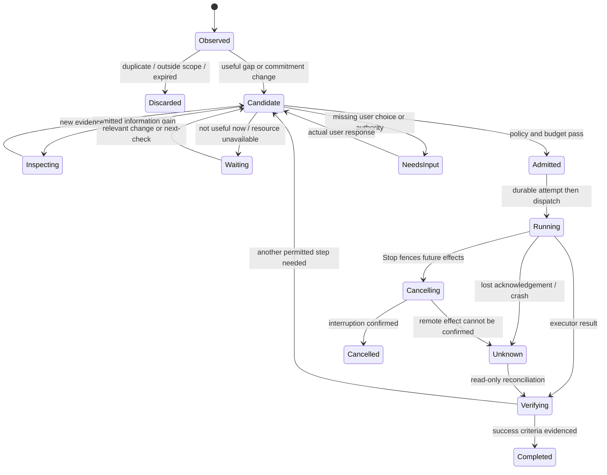
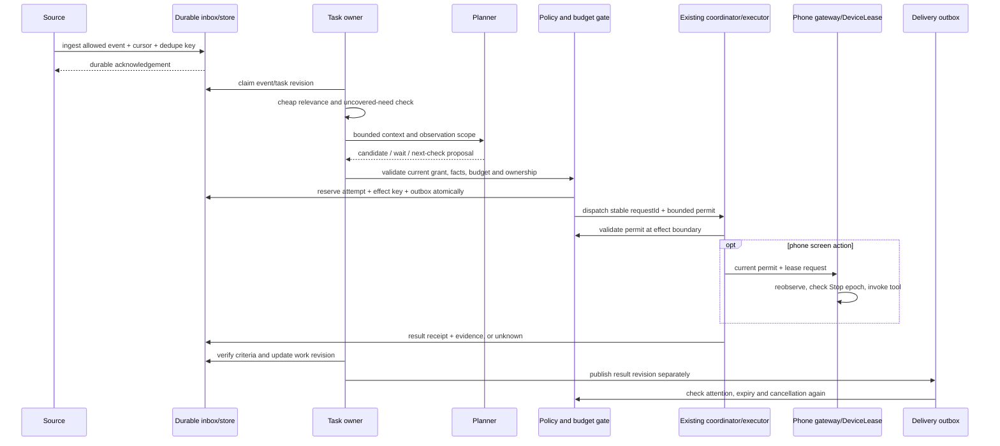

# Proactive Mike v2: architecture, discovery, and execution

25 October 2026. Independent architecture review. All new types, APIs, policies and phases below are proposals, unless marked as existing source behavior.

## 1. Decision

Build a **hybrid system with a local action gate and a movable planner**, using the existing Codex and Claude engines. Start with its phone-only deployment. Add a persistent Server coordinator only when the pilot shows a clear need for work while the phone cannot run. Pc remains an executor for its own files and tools; its name or current connection does not make it a reliable scheduler.

The first report has a sound execution foundation: commitments, a durable event queue, recorded attempts, and separate delivery. It does not yet explain how Mike finds a useful need that has no commitment or rule. Those structures track known work. Add **discovery from selected, authorized context**, a small world model, opportunity candidates, and feedback about usefulness. Discovery must be present in the first pilot, even if its first actions are quiet preparation.

Real autonomy means doing the work already covered by the user's instruction or standing scope, checking the result, and choosing a useful next step. It does not mean asking again for every step. It also does not mean treating a learned habit, an enabled OS permission, or a child's text as fresh authority.

The strongest objection is that distributed ownership and offline cancellation may cost more than a server adds. Section 12 gives a test that can reject the hybrid recommendation in favor of phone-first.

## 2. Scope and evidence rules

| Surface | Verified in this review |
|---|---|
| Writing checkout, called `R` below | `C:\Users\SHIRA\Documents\AI\Android-agent-use`; HEAD `d91ab4105cc5b06fb72fc301b16797d042d25ec8`; branch `claude/self-messages-floating-window-zl5arz`, behind its recorded upstream by 56 commits, with existing tracked and untracked changes. Source version 26 / 0.12.0. Preserved. |
| Product source, called `W` below | Existing worktree `C:\Users\SHIRA\.codex\worktrees\pc-sensitive-command-approvals-20261025`; HEAD `e6171bd30056cf3c615da7a380ccae0b9f80c542`; branch `fix/pc-sensitive-command-approvals-20261025`; clean at inspection. `version.properties:1` has 1164 / `0.14.0-dev.connect-sdk`. This is the source baseline for every code claim below. |
| Phone | Supplied runtime snapshot reports 1167 / `0.14.0-dev.pc-approvals1167`, Codex 0.163.0, Claude Code 2.1.310, accessibility connected, and Pc/Server entries. This is reported runtime context, not source-to-APK identity, a background-execution test, or a continuous-availability measurement. |
| Existing progress notes | `W/PROGRESS.md:3` records approval-profile tests and later installed-version/user feedback. These are earlier records, not tests performed in this review. They do not establish proactive discovery, cold voice start, or loss-free event delivery. |
| Research baseline | `R/docs/research/proactive-mike-2026-10-25.md`, especially sections 4–10. Read and challenged rather than treated as implementation proof. |

Read the checkout's `AGENTS.md`, `PROGRESS.md`, `docs/ARCHITECTURE.md`, and repository guard before its review. The user explicitly limits writes to this report, so no branch switch, new worktree, git write, product edit, other document edit, settings change, rule, build, install or device operation was done. No personal chat content, credentials or raw notification records were read. Architecture code that handles such data was inspected.

Evidence labels used here:

- **Source:** a path and line show a behavior or missing boundary in the inspected implementation.
- **Failure hypothesis:** a plausible interleaving or deployment failure; it has not been reproduced here.
- **Runtime proof:** a measured run on the actual target. No new physical/runtime proof was collected in this review.

Path abbreviations for the source ledger: `C = W/core/src/main/kotlin/dev/androidagent/core/`; `A = W/automations/src/main/kotlin/dev/androidagent/automations/`; `P = W/app/src/main/java/dev/androidagent/app/`; `M = W/remote/src/main/kotlin/dev/androidagent/remote/`. Every abbreviated `path:line` expands to that exact directory at HEAD `e6171bd30056cf3c615da7a380ccae0b9f80c542`.

## 3. Existing event-to-result path

### 3.1 Event input and evaluation

1. **Notification:** `A/AutomationNotificationListener.kt:60` rejects Mike's own, ongoing and group-summary notifications. It checks enabled rules' package scope before reading title/text (`:67–75`), then constructs `AutomationEvent.Notification`. The event type (`C/AutomationEvent.kt:69`) contains package, title, text and time; it has no source notification key, revision, stable event ID or durable cursor. Notification removal is ignored (`A/AutomationNotificationListener.kt:86`). This is scoped live input, not a notification history API or general discovery feed.
2. **Schedule:** `A/AutomationAlarms.kt:56` arms one `RTC_WAKEUP` alarm, exact-and-allow-while-idle when permitted, otherwise inexact-and-allow-while-idle, with a fallback on permission loss. Alarm receiver `:104` emits `Clock`; boot/package-replaced receiver `:118` calls `catchUp`. The manifest is not direct-boot-aware (`W/automations/src/main/AndroidManifest.xml:25`), so do not promise work before first unlock.
3. **Device input:** `A/AutomationHost.kt:110` registers power/screen/user-present receivers and starts Bluetooth/Wi-Fi sources. `:241` compares connection identity and state, emits only known changes, and `:289` maps broadcasts to events. These registrations are process-local. `supportedTriggers` (`:139`) does not advertise place: no geofence source exists here.
4. **Host:** `A/AutomationHost.kt:171` launches in the application coroutine scope and takes `runLock`. It snapshots conditions, evaluates every rule, runs only `Outcome.Fired`, calls `onReport`, then rearms. `catchUp` (`:197`) reconstructs only a Clock event. It cannot reconstruct a past notification or Bluetooth edge.
5. **Evaluator:** `C/AutomationEvaluator.kt:94` checks enabled state, trigger/due slot, conditions, cooldown, daily limit and attention. USER requires screen-on/unlocked; MODEL requires `agentAvailable` (`:164`). `:181` exports only action-referenced event/context fields and binds them into actions. A pure dry run does not consume quota. Attention is derived from action kinds (`C/AutomationRule.kt:101`), not supplied by the model.

The schedule has a useful owed-slot concept, not just exact-minute matching. It uses history, rule save time and the validity window (`C/AutomationEvaluator.kt:115`). The inspected device filter does not handle time/timezone-change broadcasts (`A/AutomationHost.kt:278`). A clock/zone change therefore needs an explicit rescheduling policy in the proposed design; current code is not evidence of one.

### 3.2 Actions, queued turn, and engine

6. **Attempt before action:** `C/AutomationRunner.kt:130` records the rule fire first, derives a deadline, then handles at most the parsed action set. Approval/ask gates precede their action. Reports list completed actions and uncertain committed effects (`:165–186`). A rule reaches workflows and intents through the same tools, not a separate arbitrary-shell runner.
7. **Direct action:** `A/AndroidAutomationActions.kt:83` calls `workflow_runner`; `:93` calls `open_intent`. Both use `device()` and `AgentRuns.runAutomation`. Despite an outdated comment about immediate refusal, `C/AgentCoordinator.kt:307` actually waits for availability/lease, with default 90 seconds (`:2041`). It arms/revokes the gateway under its run epoch. This is bounded in-process waiting, not durable deferral.
8. **Agent action:** `A/AndroidAutomationActions.kt:159` finds/creates a per-rule ordinary chat, submits `QueuedTurn(sessionId, prompt, validUntil)`, and returns `ok("queued...")`. Session binding is stored in shared preferences (`:176`). The queue contract (`C/SessionRunQueue.kt:35`) supports engine/model/effort, but this automation call supplies none. Its turn inherits the rule chat's engine/defaults; a rule is not yet a planner/executor selection policy.
9. **Queue:** `C/SessionRunQueue.kt:94` restores persisted turns paused. `submit` (`:108`) can steer a currently running chat; otherwise it saves, checks freshness at dispatch and durably removes the turn **before** `send` (`:137–157`). Storage is SQLite (`W/workspace/src/main/java/dev/androidagent/workspace/LocalSessionStore.kt:133`). This prevents automatic replay but leaves a dequeue-before-start crash gap. It is not a durable execution receipt.
10. **Coordinator and routing:** `C/AgentRuns.kt:195` allows uncapped parallel chats. `C/AgentCoordinator.kt:455` chooses the session/turn engine, connects, checks sign-in, opens the thread, constructs catch-up context and starts the turn with a capability snapshot (`:499`). `M/RoutingAgentEngine.kt:179` routes Claude by phone/computer binding; `:211` does the same for Codex. Existing thread ownership conflicts refuse rather than silently replace a running remote session. The selected model and supported effort should come from the target catalog (`P/SessionAgentSetup.kt:36`), not a guessed global model name.

### 3.3 Context, tools, Stop, and results

11. **Trust:** engine developer instructions mark files, apps, websites, notifications and connected-app data as untrusted (`W/engine-codex/src/main/java/dev/androidagent/enginecodex/CodexEngine.kt:1351`; `W/engine-claude/src/main/kotlin/dev/androidagent/engineclaude/ClaudeInstructions.kt:55`). However, an automation's bound prompt enters `QueuedTurn` with default `agentContext=false`, and the coordinator records it as a user message (`C/AgentCoordinator.kt:458`) before sending `handoff + prompt`. `C/AutomationRule.kt:374` substitutes event fields into the action. This typed path lacks the separate quoted event envelope used by voice and children. **Source finding:** provenance is flattened. **Unproven hypothesis:** adversarial notification text could be treated as part of the task instruction. The global untrusted-data instruction helps but is not a structural boundary.
12. **Device lease:** `C/DeviceLease.kt:32` is a process-local mutex plus owner reference, not a distributed expiring lease. `C/AgentCoordinator.kt:1217` distinguishes independent tools from lease users. Screen read/control sets sticky ownership; non-screen calls release it (`:1894–1933`). Connect and background browser work can be independent; approval/UI handoff still claims the screen. New proactive work must reuse this path.
13. **Stop:** `C/AgentCoordinator.kt:664` raises an epoch, clears local approvals, cancels tool/control jobs, revokes independent/device tools and then interrupts. `:752` can report that remote interruption was not confirmed. `C/AgentRuns.kt:280` stops a session's family; global Stop covers all slots. A local mutex and epoch cannot fence an already running computer command while the phone is disconnected.
14. **Children:** `C/SessionAgents.kt:198` requires a stable request ID, verifies repeated arguments, saves a reservation before child creation, and rechecks parent/global/child Stop fences. Message IDs separately prevent replayed steering (`:291`). Public text/run changes produce `SessionAgentUpdate` (`:331–376`), including full append/replacement segments. `C/SessionAgentDelivery.kt:20` batches in an in-memory map; `P/AgentApplication.kt:452` routes to voice or `AgentRuns.deliverAgentContext`. An idle parent can start a new ordinary turn with its saved model (`C/AgentRuns.kt:268`). Child data is explicitly quoted as neither authority nor approval (`C/SessionAgentUpdate.kt:76`, `GUIDANCE`). This already provides an event-driven continuation path.
15. **Child recovery:** nonterminal tasks become `unknown` after restart; restored history is a baseline, not a fresh wake (`C/SessionAgents.kt:119`). Delivery failures remove the batch and report uncertainty (`C/SessionAgentDelivery.kt:62`). Task persistence is stronger than delivery persistence: no durable pending-delivery outbox was found in this path.
16. **Legacy computer tasks:** `M/ComputerTasks.kt:123` reserves by source/request ID before dispatch. Restart and unconfirmed remote termination become `unknown` (`:89`, `:239`); cancel of unknown work does not invent a replacement (`:161`). This remains a separate receipt path from ordinary `session_agents`. Migration should bridge receipts, not create two owners for one job.
17. **Run result and delivery:** a finished turn/child is not proof that its real goal succeeded. `C/SessionAgents.kt:348` derives `completed` from run outcome and `:369` takes the assistant result. Automation `ok` can mean only queued or voice startup requested. Native notification posting returns after the notify API (`A/AndroidAutomationActions.kt:144`), not after the user saw it. Goal verification and delivery acknowledgement need separate records.

### 3.4 Voice: what is and is not established

The source does support a rule initiating voice: `A/AndroidAutomationActions.kt:188` checks expiry/connections and requests an activity through `AssistLaunch`. `P/VoiceConversation.kt:129` starts voice and `:195` injects context before the opening. `C/AutomationVoiceRequest.kt:64` JSON-quotes rule/event data, rechecks expiry/output conditions, then speaks through `AndroidRealtimeVoiceController.appendSpeech` (`W/voice/src/main/kotlin/dev/androidagent/voice/AndroidRealtimeVoiceController.kt:301`). Connection loss is checked while the call runs (`:327`).

The host's reachability check is screen interactive and unlocked (`A/AutomationHost.kt:262`), **not “Mike's activity must already be open.”** The app declares a `VoiceInteractionService` and a foreground service with `specialUse|microphone` (`W/app/src/main/AndroidManifest.xml:57`, `:75`). The service handles microphone-type refusal (`P/AgentService.kt:82`). None of this proves that a cold automatic call starts, captures audio and speaks correctly on a specific phone. Do not repeat the unsupported open-app-only claim, or replace it with an equally unsupported always-works claim.

## 4. What the first report missed or needs to qualify

| Finding | Evidence and consequence |
|---|---|
| “Held” is not generally stored | The evaluator's retryable skip is only a value. Host filters to Fired; unlock catch-up emits Clock only. A scheduled slot may remain owed; a notification rejected for user/model availability has no durable replay in this path. The architecture prose (`W/docs/ARCHITECTURE.md:2164`) overstates this distinction. |
| Attention blocks model work more broadly than execution requires | `P/AgentApplication.kt:505` uses `runCoordinator.available`; `C/AgentRuns.kt:173` means no chat active, although `:195` permits parallel chats. Thus a background model rule can be skipped while unrelated read-only work is running. This is a code-policy mismatch, not a measured missed-event count. |
| Record-before-act is incomplete if recording silently fails | `C/AutomationJournal.kt:120` wraps writes/rename/fallback in `runCatching` without propagating failure; in-memory history can advance when disk did not. Unreadable/corrupt history also loads empty (`:106`). A later restart could forget attempts. Disk-full/crash reproduction was not run. |
| Validity lacks an end-to-end event deadline | Host snapshots at `event.at`; runner computes `validUntil` from execution time (`C/AutomationRunner.kt:137`). A notification delayed behind the serialized runner can receive a fresh lifetime. Carry event occurrence, observation and expiry separately; revalidate real state before effects. |
| Queued/speaking/completed are different receipts | Queue removal, turn completion, objective evidence, artifact persistence and delivery have separate crash windows. A single boolean `ok` cannot stand for all five. |
| Automation origin is not carried through Connect wiring | `C/ConnectedApps.kt:50` defaults `origin()` to `chat`; `:128` checks standing automation permission only for `automation`. `P/AgentApplication.kt:358–374` constructs the gateway without overriding origin. Direct workflows and automation-origin agent turns have no typed origin passed here. This is a concrete missing provenance boundary; no unauthorized provider write was attempted. |
| Children already continue parents, but not through a durable event log | Their fences, quoted context and stable IDs are valuable. Their in-memory delivery map and unknown-on-restart policy do not yet provide task resumption across crashes. Reuse them rather than design children as a future capability. |
| Durable app knowledge is not a complete personal world model | Knowledge records are package/screen/selector facts (`C/KnowledgeStore.kt:77`). Shared preferences and skills exist (`W/workspace/src/main/java/dev/androidagent/workspace/WorkspaceSeeder.kt:113`, `:145`), but the inspected source has no `PersistentMike`, `MikeStateStore` or opportunity/commitment domain implementation. Earlier memory pointed to separate work; it was not assumed merged. |
| A server is an option, not a fact about today's deployment | Current code routes engines over existing computer bindings and retained connections. No persistent proactive coordinator or measured always-on Server service was established. Do not promote “Server is listed” to 24/7 execution. |

The first report is right to separate “worth checking,” “worth working,” and “worth interrupting.” Its proposed sequence postpones inferred initiative until the end. That could produce a more reliable reminder/task follower while leaving the user's central request unmet. Test new-need discovery from the start within an existing approved scope.

## 5. Three serious deployment choices

| Dimension | Phone-first event-driven | Persistent coordinator on Pc/Server | Hybrid planner plus local action gate |
|---|---|---|---|
| Authoritative state | Phone database; Android wake adapters | Coordinator database; phone is an executor | One owner per task shard; phone owns local grants and phone effects; planner can be local or delegated |
| New-need discovery | Local event/delta sampling plus bounded model turns | Rich cross-project scanning within approved roots/feeds | Cheap local relevance checks; only selected context goes to a planner; results return as candidates |
| Phone asleep/offline | Durable pending state; Android may delay processing; cloud models need network | Server can keep its own authorized network/file work moving; cannot observe offline phone state | Independent preparation continues remotely; phone actions wait for a current local admission |
| Pc asleep or SSH lost | Phone continues its own work | Pc scheduler may disappear; use Server only after availability is established | Phone retains its bounded local lane; no silent takeover of an uncertain remote attempt |
| Doze/reboot/force-stop | Main availability limit; reconcile after allowed restart | Server survives phone process loss but cannot bypass stopped-state behavior or local grants | Explicit degraded states and reconciliation; no phone-wake guarantee |
| Stop while disconnected | Local tools stop; remote effects need reconciliation | Remote Stop works only if the cancel reaches its owner; phone cannot promise an immediate remote stop | Durable cancel plus short delegated authority; local Stop is immediate locally, remote Stop is pending until ack/expiry |
| Ownership and races | Simple, one DB; existing screen mutex | Central owner simplifies scheduling, but phone grant state can be stale | More protocol work: generation/fence/receipt at each executor; no two schedulers freely claiming the same effect |
| Cost and privacy | Lowest data movement and operations burden | More uploaded context and always-on resource cost | Minimize data movement and shared budget, but more sync and diagnostics |
| Best fit | Small scopes, no hard response SLA while phone sleeps | Long research/network jobs and server-local source events | Mike's combined phone/computer work if offline preparation adds proven value |

**Choice:** implement the hybrid contracts and a phone-only owner first. Do not create an always-running model loop. Later deploy the same coordinator contract on Server for explicitly delegated scopes. Pc and Server are selected by capability, approved root, sign-in, cost and health, not by a fixed preference for the larger machine.

No automatic owner failover for effectful work after a timeout. A new owner may plan or read safely while an old attempt is uncertain; it cannot repeat that attempt until it can reconcile it or the user chooses a new action. “Lease expired” proves loss of authority for future accepted calls, not that an old external write did not happen.

## 6. Android constraints checked against current official documentation

This source targets/compiles API 35 (`W/app/build.gradle.kts:10`, `:14`). Platform behavior, target level, granted role and current lifecycle all matter. These official pages were checked during this review; they are not physical-device evidence.

| Concern | Documented rule and proposed response |
|---|---|
| Doze | Network access, jobs and ordinary alarms can be deferred. Use durable input and deadline-aware catch-up; an alarm callback is not a promise of an immediate model connection. [Doze and App Standby](https://developer.android.com/training/monitoring-device-state/doze-standby). |
| Periodic checks | WorkManager periodic work has a 15-minute minimum and timing depends on constraints/system scheduling. Use it for reconciliation and coarse review; do not describe it as a minute-level heartbeat. [Define work requests](https://developer.android.com/develop/background-work/background-tasks/persistent/getting-started/define-work). |
| Receiver lifetime | Returning from a manifest receiver does not keep asynchronous work alive. `goAsync` still has a bounded completion window. Durably ingest a small event, finish promptly, then schedule managed work. `scope.launch` in the current alarm path does not itself provide that handoff. [BroadcastReceiver](https://developer.android.com/reference/android/content/BroadcastReceiver). |
| Exact alarms | Exact alarms are for justified time-critical cases and may need special access; inexact delivery has timing limits and power-related delays. Keep flexible checks flexible; rearm after reboot and permission changes. [Schedule alarms](https://developer.android.com/develop/background-work/services/alarms). |
| Foreground startup and microphone | Android 12+ limits background FGS starts. Android 14+ separately checks while-in-use permission eligibility at service creation. The documented exceptions include notification interaction and an app providing `VoiceInteractionService`. A background-start exception alone is not necessarily microphone eligibility. Check the real role, binding and start path. [Background FGS restrictions and microphone exceptions](https://developer.android.com/develop/background-work/services/fgs/restrictions-bg-start). |
| Screen/activity startup | Background activity starts have separate restrictions; a visible notification is a fallback when a lawful automatic launch cannot proceed. Screen unlocked is an attention signal, not platform authorization to launch. [Activity security](https://developer.android.com/guide/components/activities/secure-bal). |
| Force-stop | Android 15 cancels PendingIntents on force-stop; the stopped package leaves that state through user interaction, then receives BOOT_COMPLETED to rebuild them. Do not try to make force-stop self-resume. Preserve pending state and explain degraded availability after a permitted restart. [Android 15 stopped state](https://developer.android.com/about/versions/15/behavior-changes-all#stopped-state). |
| Long workers | On Android 16, long-running WorkManager jobs using FGS can exhaust job quota. Break work into checkpointed pieces; direct FGS is also subject to its own eligibility rules. [Long-running workers](https://developer.android.com/develop/background-work/background-tasks/persistent/how-to/long-running). |

Do not equate activity closure, Recents dismissal, process death, task-manager Stop, force-stop, reboot and offline operation. The pilot needs separate cases. If voice cannot start, retain its useful result and choose the approved delivery fallback; do not rerun the original work or report that speech happened.

## 7. Concrete domain and ownership model

Use versioned records in the existing durable store layer, with transactions and a bounded outbox. No extra agent framework is required. Schemas below are conceptual contracts, not claims that new tables already exist.

```text
ScopeGrant {
  id, revision, issuer=user, sourceInstructionRef, exactInstruction,
  purposes[], allowedSourceFields[], allowedRoots[], destinations[],
  allowedActions[], effectLimits, automationPolicy, validUntil?,
  cancelEpoch, attentionPolicyId, budgetId, delegatedExecutors[]
}
EventEnvelope {
  id, sourceId, sourceSequence?, sourceObjectId?, revision?, kind,
  occurredAtUtc, observedAtUtc, receivedAtUtc, originZoneId?,
  sourceBootId?, monotonicObservedAt?, expiresAtUtc,
  scopeGrantId, sourceCursor?, causationId?, correlationId?,
  provenanceRef, allowedPayloadRef?, payloadHash, dedupeKey
}
Fact {
  id, subject, predicate, valueRef, provenanceRefs[], trustLabel,
  observedAt, validUntil?, revision, supersedes?, confidenceClass
}
Opportunity {
  id, topicKey, scopeGrantId, kind=commitment|discovered,
  evidenceRefs[], proposedBenefit, uncertainty, noveltyKey,
  possibleNextSteps[], disposition, suppressedUntil?, reviewAfter
}
Commitment {
  id, exactInstructionRef, goal, successCriteria[], scopeGrantId,
  ownerNodeId, ownerGeneration, revision, state, dependencies[],
  nextCheck{reason, earliestAt, latestUsefulAt, sourceCursor?},
  budgetId, cancellationEpoch, lastDecisionId, resultRefs[]
}
Decision {
  id, inputEventIds[], factRevisions[], opportunityId,
  choice=ignore|wait|inspect|prepare|act|ask|deliver,
  reason, policyVersion, grantRevision, costReservationId?,
  proposedPlanRef?, nextCheck?, expiresAt
}
Attempt {
  id, commitmentId, decisionId, parentAttemptId?, executorId,
  ownerGeneration, grantRevision, cancelEpoch, requestId,
  effectKey, argumentHash, state, heartbeat?, executionDeadline,
  receiptRef?, verificationRefs[], reconciliationPolicy
}
Delivery {
  id, resultRevision, audience, channel, attentionPolicyRevision,
  dedupeKey, notBefore, expiresAt, state, submittedAt?, ackKind?, ackAt?
}
Budget {
  id, window, revision, modelUse, computeTime, networkBytes,
  maxChildren, maxActiveAttempts, attentionUnits, reservations[]
}
```

`ScopeGrant` records task authority that the user actually gave. It does not replace Android permission, Connect capability grants, a computer's native approval policy, or a tool's required confirmation. Import those existing boundaries as constraints. `exactInstruction` is immutable source text; any normalized goal is a separate field. Inferred preferences and imported skills cannot create or widen a grant.

Keep sensitive event content outside the general event log. Store only allowed fields or a short-lived local reference. Scope the fingerprint to the user/source so it does not become a public identity. Revocation deletes or expires retained content according to policy, preserves minimal non-content cancellation/idempotency tombstones, and removes it from future planner context. A hash alone does not make sensitive data anonymous.

Three different ownership concepts are required:

1. **Task owner:** one durable coordinator that decides the next step. Change it by compare-and-swap on revision/generation, not by last-writer-wins sync.
2. **Executor permit:** a bounded, attenuated capability for one attempt, carrying task generation, grant revision, cancel epoch, audience, allowed resources and expiry. Each effect gateway verifies it at dispatch. A remote executor cannot mint more authority for its children.
3. **Phone screen owner:** existing `DeviceLease`, retained for observation/action continuity. A planner must not hold it during reasoning, network waits or user questions. Reobserve after yielding it; old UI node handles are not transferable permits.

The phone remains authority for local capability grants and phone actions. A Server may own a task's planning and independent preparation under a pre-issued bounded permit. There is no multi-writer authority document. Writes needing fresh phone state wait for phone admission. Server-local actions can continue offline only if the delegated scope explicitly permits offline work; otherwise they wait too.

For clocks, store UTC instants and the user's IANA zone separately. A recurring local-time slot has a stable ID and an explicit DST fold/gap policy. Deadlines derive from the useful event time, not the most recent retry. Durations within a boot use a monotonic clock; persisted timers also carry boot ID and are reconciled against wall time after reboot. Remote expiry uses the executor's bounded monotonic permit lifetime plus UTC validation with a permitted skew bound. Excessive skew pauses effects and requests clock reconciliation; it must not extend authority.

## 8. Discovery: finding a need before a commitment exists

### 8.1 Inputs Mike can actually use

Use a catalog of **permitted observations**, not all data that an installed app or computer could technically expose.

| Input | Existing basis and proposed use |
|---|---|
| User goals and corrections | Capture an explicit instruction/correction as a source reference when it is given. Read only the context authorized for this scope. Do not silently ingest all chat history. A past request is not automatically an active goal. |
| Preferences | Shared `$HOME/preferences.json` and the user-preferences skill are installed across chats (`WorkspaceSeeder.kt:113–170`). Extract context-specific defaults with source/time; do not treat model-writable preference text as permission. Keep user corrections above inferred habits. |
| Operational knowledge | `C/KnowledgeStore.kt:110`, `:160` supplies package-specific selectors with age/stale handling. It helps choose an implementation after finding a need; it does not identify personal goals by itself. |
| Skills and workflows | Discover per workspace/engine through the current catalogs (`M/RoutingAgentEngine.kt:162`; `WorkspaceSeeder.kt:145`). Index ability, required inputs, side effects and evidence of past success. A skill's instructions do not authorize a new task. Known workflows remain a cheap executor for selected work. |
| Mike Connect | `C/ConnectedApps.kt:23` defines discover/capabilities/call/openUi. It validates signer-bound capability grants and policy hashes (`:112–133`); output is wrapped as `untrustedAppData` (`:198`). Provider writes reserve request IDs in `W/connect-sdk/src/main/java/dev/heymike/connect/MikeConnectService.kt:122`, finish at `:144`, and leave uncertainty on interrupted reservations. Discovery can poll allowed READ capabilities with cursors/deltas if that capability supports them. |
| Connected-app events | Not an existing subscription feed. The provider dispatch has tools/list and tools/call (`MikeConnectService.kt:80–95`); current host transport ignores callback notifications (`W/connect-host/src/main/java/dev/androidagent/connect/AndroidConnectTransport.kt:103`). Add a separately versioned, signer-checked event permission/cursor/retention contract later. A capability grant must not silently become permission to stream personal data. |
| Child/computer results | The ordinary child flow already supplies public deltas and status. Convert a result revision into a durable event, preserving child/source IDs, Stop fence and untrusted provenance. A result may reveal a new blocker/opportunity within the parent's purpose; it cannot grant access, approve a gate or redefine that purpose. |
| Pc/Server | Use the saved computer/project catalog, approved roots, target model catalog and connection status. These are candidate execution locations, not evidence that a desktop is signed in or a service is always running. `M/RemoteStore.kt:34` maps Codex ASK/FULL to workspace-write/danger-full-access with on-request approval; `M/RemoteHub.kt:782` gives Claude its own permission mode. Do not assume equal native enforcement between engines. |

The snapshot's connected Ghostride/LumaStand entries show that connections are present; they do not establish which fields or actions the user allowed. This review made no calls to either app. Discovery first asks the existing grant catalog, then chooses the smallest relevant allowed observation. If the necessary observation is not permitted, Mike may describe a useful optional scope once, without pretending it already read the data.

### 8.2 A bounded discovery cycle

1. **Maintain small baselines.** Track authorized subjects, pending conditions, recent user corrections, selected source cursors, already prepared artifacts and capability revisions. Keep explicit unknowns. Store facts separately from assumptions, proposals and authority.
2. **Wake for a change or an information gap.** Inputs include a relevant source delta, a newly available capability, a child result, a deadline approaching, or a scheduled review of a selected domain. A low-rate review allows discovery when no event arrived. A heartbeat alone gives no useful reason to read everything.
3. **Apply cheap tests before a model.** Scope, freshness, changed revision, topic suppression, budget, known-completed work, negative feedback and causal-loop checks discard most input. Match facts to open commitments **and** search for uncovered needs within active scopes. Group related signals before reasoning.
4. **Build a limited context packet.** Include the user's purpose verbatim, selected fact references, uncertainty, allowed observation/action summaries, previous candidates and current costs. A read-only inspection can be proposed if its expected information value is high. Do not add screen capture or raw notifications merely to enrich a prompt.
5. **Generate structured opportunities.** Require: the observed gap; why it matters to this user's authorized purpose; source facts; how the hypothesis could be wrong; the cheapest useful next step; success evidence; useful lifetime; and the benefit of acting now versus waiting. “The user might like this” without evidence is not enough.
6. **Validate outside the model.** Check source revisions, grant revision, allowed recipients/roots, effect class, deadlines, duplicate/suppressed topic and reserved budget. The decision can be inspect, quiet preparation, authorized action, a scoped question, wait or discard. Novelty affects usefulness, never permission.
7. **Execute a small step and compare the result.** If new facts invalidate the opportunity, stop cheaply. When an allowed preparation succeeds, save its artifact and evidence without requiring an immediate notification. Promote a valuable candidate into a tracked commitment only within the existing purpose and lifetime.
8. **Learn from outcomes.** Keep “useful,” “already done,” “not now,” “wrong topic,” and “stop this kind of help” distinct. Nonresponse is weak evidence about attention, not approval. An inferred preference can tune ranking but cannot widen collection or execution authority. Keep rejected candidates so the same idea does not return after each fresh heartbeat.

**Example of a new need, not task continuation:** suppose the user has already authorized “prepare briefing drafts for my selected work calendar using files in this project; do not send them.” A newly observed meeting has no briefing artifact and no explicit task record. Mike can detect that gap, inspect only the permitted project index, and prepare a useful draft under the standing scope. It does not need a prewritten event-to-briefing rule or a new approval for the same preparation. If the meeting has no source material, a quiet note or one targeted question is better than an invented briefing.

**Example of a learned pattern:** several explicitly permitted preparation tasks use the same successful workflow. Discovery can propose a reusable routine and estimate benefit, or reuse the workflow for another task already covered by the current scope. Repetition alone does not permit a permanent routine, extra data collection or sending. A one-off instruction stays one-off.

Commitments plus an event queue can continue known work well. They will miss the first example unless some component compares desired state with observed state and generates an unassigned candidate. A model reading an “open tasks” list repeatedly is still only continuation. Discovery needs its own coverage/usefulness metrics, so an implementation cannot pass by reliably doing nothing new.

### 8.3 Planner isolation and prompt injection

The planner returns a decision proposal and evidence references. It does not mutate grants, create arbitrary queued prompts, call arbitrary tools, spawn unrestricted children or send user-visible output by default. An application-owned context envelope carries trusted metadata separately from untrusted payloads. Preserve that separation across engine switches, summaries and child handoffs.

Do not rely on a system prompt, JSON quoting or plan mode alone to stop native shell/file effects. Codex/Claude have engine-native capabilities in addition to Mike's dynamic tools. A planner deployment requires a tested restrictive execution profile, no ambient write credentials or unrestricted MCP tools, and an output-schema validator. If the adapter cannot enforce that profile, run planning in a constrained worker that exposes only the allowed observations. Keep the engine; narrow its execution surface. Action execution returns to the normal coordinator with a validated permit.

Treat app descriptions, schemas, skills from external sources, notification text, retrieved files and child claims as data with provenance. Information may support a fact only with its source label. It cannot become `exactInstruction`, change grant revision, alter the recipient or root, request another model's tools, or resolve a human approval. Summaries carry the source taint. A validator also checks the **proposed goal**, since a malicious but permitted read can still steer Mike toward an irrelevant agenda.

## 9. State machines, API boundaries and sequence

### 9.1 State transitions



This is a work decision machine. Each attempt separately follows `reserved -> dispatched -> acknowledged -> verifying -> succeeded|failed|unknown|cancelled`. `unknown` must not transition directly to `dispatched` through a generic retry. A never-dispatched reservation can safely be released. A read-only/idempotent operation can retry only under its declared reconciliation policy with the same effect key and arguments.

Delivery is independent: `pending -> eligible -> submitted -> acknowledged`, or `held|expired|unknown|cancelled`. “Acknowledged” names what was observed: stored in chat, notification posted, voice connection ready, speech submitted, or user seen where a supported signal exists. Do not claim one from another. Unknown speech delivery does not rerun the underlying task.

### 9.2 Event-to-decision sequence



Use at-least-once event transport with deduplicated processing. External exactly-once execution is not promised. Inbox insertion and cursor advancement share a transaction. Attempt reservation, budget reservation and a dispatch outbox item share another. Marking a result and creating its delivery item are atomic locally. A remote acknowledgement cannot be made atomic with an unrelated third-party write; use provider receipts and read-back reconciliation.

### 9.3 Responsibility map

| Existing module/surface | Responsibility in the proposed design |
|---|---|
| `core` | Domain schemas, pure admission/attention policy, discovery proposal validation, state transitions, owner generation, budgets, cancellation contract and deterministic tests. |
| `workspace` | Transactional inbox, tasks/facts/opportunities, attempts, dedupe tombstones, result store and delivery outbox; scoped retrieval with provenance. Keep transcripts separate from authority. |
| `automations` | Android event adapters, bounded receiver ingestion, alarms/WorkManager reconciliation, device/notification scope filtering and platform capability state. Existing rules remain supported. |
| `app` | Wire ownership and existing engines; expose scopes, prepared work, reasons, pending actions and Stop. Translate real user choices to grant revisions. Handle notification/deep-link delivery and startup reconciliation. |
| `engine-codex`, `engine-claude`, `remote` | Engine adapters and constrained planner profiles; stable task/attempt correlation, remote receipts, reconnect/status/cancel protocol. Retain their real native approval and sign-in boundaries. |
| `device-tools`, `a11y`, `adb`, `overlay` | Existing sole phone-action path, observation revisions, permit/epoch checks, screen lease, visible control and direct local Stop. Discovery adds no second phone gateway. |
| `voice` and `VoiceConversation` | Audio lifecycle, output routing, existing child-update speech gates, expiry and connection checks. Accept delivery requests; return explicit submission/failure evidence. |
| `connect-host`, `connect-sdk`, `connect-protocol` | Preserve signer/capability policy and provider idempotency. Pass application-owned origin; optional future event contract uses independent source permission, cursor and backpressure. |
| `session_agents` / `computers` | Execute authorized child work with stable IDs; keep ordinary interactive chats and existing target access policy. Bridge their receipts to the parent's attempt and shared budget. No hidden replacement children. |

### 9.4 Internal APIs

These are contracts for implementation, not new tools to install now:

```text
ingestEvent(envelope, expectedCursor) -> inserted | duplicate | rejected
evaluateBatch(scopeId, eventIds, expectedTaskRevision) -> DecisionProposal
admitDecision(proposal, currentRevisions) -> Permit | Wait | NeedsInput
reserveAttempt(permit, effectKey, argumentHash, expectedGeneration) -> Attempt
dispatchAttempt(attemptId) -> existing session/workflow/computer receipt
reportResult(attemptId, fence, receipt, evidence) -> accepted | staleResult
cancelTask(taskId, expectedRevision, mode) -> localRevoked, remotePending[]
reconcileAttempt(attemptId) -> verified | notExecuted | stillUnknown
scheduleNextCheck(taskId, reason, earliestAt, latestUsefulAt)
submitDelivery(resultRevision, channel, dedupeKey) -> delivery receipt
```

`origin`, grant references, ownership and cancellation fields come from app-owned state, never model-written JSON. Carry them through workflows, automation turns, children, computer relays and engine handoffs. Fix the current Connect origin default at that boundary, rather than ask the model to remember to label itself “automation.”

An executor checks permissions again immediately before a write, UI launch or delivery. A remote shell can spawn processes that outlive its caller: fencing a phone RPC does not fence those native effects. A persistent coordinator therefore needs executor-side process supervision, a bounded run lifetime and effect adapters where enforcement is required. For arbitrary native commands, record the practical limit and preserve `unknown`; do not claim distributed fencing makes an already issued command reversible.

## 10. Next-check, attention, and budgets

Keep three decisions separate: **inspect**, **work**, and **interrupt**. A useful preparation can happen quietly; a successful task can wait for a digest. An explicitly requested alert keeps its delivery promise and is not suppressed simply because a model predicts low interest.

For each waiting item, save a specific next-check reason: dependency result, source cursor advance, expected external change, resource availability, deadline preparation, or bounded exploration review. Prefer an event subscription where it exists. Otherwise poll the permitted source at a rate based on expected change and latest useful time. Back off unchanged results, add jitter, and coalesce checks by source. A deadline can shorten the next check; it does not justify reading extra sources.

Conceptually choose the earliest useful eligible check after accounting for source readiness, backoff, quiet/work constraints and available budget; never schedule beyond `latestUsefulAt` as if the work were still timely. If no useful time remains, close as expired and report only when the user's policy requires it. A model may propose a next check; deterministic limits clamp it. Wall-clock changes recompute schedules using stable slot IDs rather than creating fresh opportunities.

Attention policy uses declared quiet periods and selected channels, urgency, existing conversation state, topic cooldown, relevance and prior feedback. Screen unlocked alone is weak evidence of willingness to be interrupted. Offer one clear place to see “watching / preparing / ready / needs a choice,” with a short “why now” and source reference. Keep “pause announcements,” “pause this topic,” “Stop this task,” and “revoke this scope” distinct. A quiet-mode choice must not silently cancel useful background preparation.

For voice, reuse the existing child announcement design: receive context separately from speaking, group useful results, avoid user/assistant speech, recheck route and Stop at submission. An automatic opening is a delivery action with its own platform eligibility. No continuous listening or screen recording is needed for discovery. If voice is unavailable, hold or use a previously allowed notification/chat fallback.

Budgets belong to the parent scope and cover all attempts/children on all devices. Reserve before dispatch; settle observed usage afterward. Child creation attenuates scope and allocates part of the same budget; it does not clone the allowance. Cap active attempts and total descendants even though `AgentRuns` currently allows uncapped chats. Unknown attempts retain their possible spend/effect reservation until reconciled or explicitly closed.

Disconnected executors use preallocated non-overlapping budget slices and bounded permits. They cannot each spend an assumed global remaining balance. Provider usage reports can be late, so use conservative reservations and state the overshoot limit. A provider account being signed in does not authorize new paid API use. Budget exhaustion should stop optional checks and retain useful state; do not switch engine/account or create a replacement agent to escape a limit.

For an initial pilot, a small configurable cap such as two nonurgent notifications per day is a test setting, not a research result or a universal preference. Quiet preparation and discovery model use have separate limits so an attention cap cannot hide unbounded computation.

## 11. Threat and failure review

| Scenario | Required behavior and test |
|---|---|
| Notification/alarm/unlock arrive together | Insert stable IDs, group candidates, CAS the task and reserve one effect. Inject reordered/duplicated inputs; one semantic action and one result revision. For notification updates, use source object plus revision rather than title text alone. |
| Rule event skipped while busy/locked | Persist a minimal permitted event or candidate with original expiry and skip reason. On availability change re-evaluate current conditions. Expired input never becomes a fresh instruction. |
| Crash during journal/inbox save | Failed durable write refuses dispatch. Corrupt stores enter repair/quarantine instead of resetting idempotency history to empty. Inject disk-full, failed rename and restart between every persisted transition. |
| Crash after queue removal, before turn start | A reserved attempt/outbox remains inspectable. Reconcile whether the executor accepted it using the stable key; do not silently lose it or assume it ran. |
| External action succeeded, acknowledgement lost | Record `unknown`; read state/receipt with the same identity. Never generate a new request ID for a retry of the same effect. Provider idempotency keys must bind arguments and caller; UI actions without such receipts need special reconciliation. |
| Stop races with child preparation or lease acquisition | Increment durable cancellation epoch first, revoke dispatch and approval tokens, then interrupt. Recheck at dispatch and after lease acquisition. A child finishing later may store evidence but cannot wake or resume the cancelled task. |
| Phone stops while Server is disconnected | Show local revocation and remote cancel pending. Remote executor stops when it receives cancel or its local permit expires. Already issued effects remain possible. Do not promise instantaneous global Stop without connectivity. Test partition immediately before/after dispatch. |
| Lease expires while a command still runs | Refuse new effects under the old fence, preserve attempt uncertainty, and prevent another owner replaying the command. Expiry is not evidence of process death. |
| Parent/child results cross engine switches | Preserve task IDs, message revisions, source taint and cancellation generation. A late result can update evidence, not choose a new engine or approve a pending human gate. Test completion before switch, during handoff and after Stop. |
| Child completion storm | Batch by parent/topic/result revision with shared compute and attention caps. Prefer latest useful progress while retaining terminal evidence. Avoid waking every ancestor into unlimited model turns. |
| Reboot, force-stop, offline or permission loss | Reconcile source cursors and unfinished attempts after a lawful wake; paused/unknown stays explicit. Do not resurrect cancelled scopes. Test force-stop separately from process kill. |
| DST, manual clock jump, timezone change | Preserve slot identity, use explicit zone policy and monotonic durations, rearm schedules. Repeated local hour does not create two effects; a skipped hour follows the chosen catch-up policy. |
| Malicious event or child says “user approved” | Payload remains quoted and tainted; grant store and approval parser reject it as authority. Include the same attack after summarization, skill retrieval, workflow output and remote handoff. |
| Provider changes schema/access/signer | Existing policy hash/signer checks continue to refuse unreviewed capability changes. New event subscriptions are separate grants. Metadata alone cannot widen scope or trigger a write. |
| Automatic task uses Connect through a workflow | Verify app-owned automation origin survives every hop and is checked at the gateway. Test WRITE without `automationAllowed`, READ with revoked grant, SENSITIVE, and grant change during a pending call. |
| Allowed read returns an irrelevant sponsored goal | Require evidence-to-purpose mapping and independent usefulness review. Taint-aware tool restriction alone cannot prevent bad goal selection. Test an attractive but unrelated recommendation inside valid app data. |
| Recurring self-generated signals | Propagate causation IDs and suppress event cycles. Mike's own results/artifact writes do not create unbounded new initiatives. A child result may advance its parent once per meaningful revision. |
| Delivery loses acknowledgement | Keep result success separate from delivery unknown. Deduplicate channel submission; a lost speech/notification receipt never reruns the task. Do not equate posted with seen. |
| Unavailable model or usage limit | Cheap local rules, saved state and already valid results still work. Hold optional reasoning and expose the reason. No repeated retry loop, new account, or replacement child. |

A sensible autonomy policy applies these gates automatically. The user should see a question only for missing intent, a new scope, or an action the current native/OS/tool policy really requires them to approve. Routine read-only checks, preparation and later steps within an accepted scope should continue without repeated consent screens.

## 12. Migration and a pilot that can reject the design

No dates or implementation effort estimates are asserted. Each phase has a product behavior and an evidence gate.

| Phase | Integration | Exit evidence |
|---|---|---|
| A. Durable execution foundation | Add inbox/attempt/outbox records behind existing rule actions. Propagate origin, event expiry and cancellation metadata. Keep legacy rule IDs and journal history. | Fault-injection tests cover save failure, duplicate events, dequeue gap and unknown effects. Old rules retain their semantics; no silent replay of uncertain work. |
| B. Phone-only discovery and preparation | Introduce scopes, facts and opportunity candidates. Use selected sources and existing workflow/engine execution. Keep discovery proposals visible in a review log; allow quiet preparation where already covered. | Novel-need scenarios produce useful evidence-backed candidates without prewritten rules. Rejected/expired topics stay suppressed. Measure model/network/attention cost. |
| C. Join child/computer outcomes | Bridge `session_agents` and legacy computer receipts into one task history; retain ordinary child chats and current approval routing. Add durable delivery and shared budgets. | Restart, concurrent results, parent Stop, engine switch and remote loss do not duplicate work or lose terminal evidence. Direct user continuation in a child remains possible with its authority clearly recorded. |
| D. Optional persistent Server owner | Deploy the same owner/permit/result contract only for a selected offline work scope. Use explicit ownership handoff and durable cancellation. No automatic failover of unknown effects. | A real partition/reconnect test demonstrates useful remote preparation, bounded Stop delay, stale-fence rejection and no replay. Document actual Server uptime and source freshness rather than assume them. |
| E. Broader authorized action | Expand scopes/actions after the earlier evidence, using existing tool/native approval rules. | Goal success and usefulness remain acceptable at the same budgets; extra action scope does not increase repeated questions or out-of-scope effects. |

Migration is additive and versioned. Do not rewrite existing user's rule files to fit the new domain. Legacy journal timestamps can prevent old schedule slots being replayed, but cannot be invented as complete task receipts. Mark their provenance as legacy. Let only one runner own each rule during rollout; shadow evaluation must not dispatch. Keep current restored-queue pause behavior for old turns. New unattended resumption is allowed only for records that carry the required scope, generation and receipt semantics.

On rollback, disable the new scheduler and revoke its permits before returning ownership. Preserve attempts, cancellation tombstones and results; dropping a database table would lose the evidence needed to avoid replay. No product migration, rule conversion or rollback action was performed for this research.

### 12.1 Acceptance cases

Run deterministic/simulated tests first, then a separately authorized physical pilot. The following are proposed acceptance conditions, not results:

- At least 100 seeded crash/reorder/duplicate transition traces, plus each failure row above. Zero out-of-scope effects, zero duplicate non-idempotent effects, and zero locally admitted effects after a processed Stop/revocation. Count unknowns honestly.
- A task not dispatched before a crash is either recovered safely or reported lost/held with a reason. A possibly dispatched task is reconciled or remains unknown; neither can be labelled complete because the queue is empty.
- End-to-end correlation from event or discovery evidence to decision, permit, attempt, verifier and delivery. Every automatic action can answer “why this, why now, under which user instruction?”
- Successful quiet preparation in at least one new-need case without a rule or existing commitment. The resulting artifact must be judged useful and have source evidence. A candidate record alone is insufficient.
- Same-scope follow-up steps proceed without another authority question. Tests also verify that a newly required source/recipient/action does not inherit consent from an inferred preference.
- Shared child budgets stay within reserved limits; a Stop during setup blocks dispatch; results after cancellation do not restart the parent.
- For physical coverage: API/OS version, installed APK identity, notification access, actual assistant role, permissions, foreground/background/locked state, audio route, Doze, reboot/first unlock, and force-stop are recorded separately. Voice passes only when the opening is actually heard and microphone/output behavior is checked, not when `startActivity` returns.

No finite test establishes universal exactly-once external behavior. These gates check the defined invariants and the stated uncertainty policy.

### 12.2 Strongest counterargument and rejection test

**Counterargument:** the phone already has the relevant personal context, durable rule timing, parallel engines, child continuation, local Stop and access to computer executors. A persistent coordinator adds replicated grant versions, split ownership, stale authority, offline budgets and uncertain cancellation. If the useful work is brief or can wait until the phone is awake, phone-first plus good discovery may deliver the same experience with fewer failure modes. Calling the system hybrid does not justify operating a service.

Test three modes against the same selected scopes, source snapshots and model budget: **(1)** commitments+events only, **(2)** phone-first with discovery, **(3)** hybrid with the same discovery. Use 40 fixed cases, half known-work continuation and half useful needs without an existing commitment; include phone/Server partitions and duplicates. Human review should not know which mode produced each candidate or artifact. This is a practical engineering gate, not a statistically powered user study.

Pre-register these provisional decision rules:

1. Reject commitments-only as the complete product if it cannot identify useful new needs without manually adding rules. Discovery should improve useful-new-need recall by at least 20 percentage points over that baseline within the same budget, while at least 80% of surfaced candidates are judged useful. If it does not, revise the discovery mechanism before adding more infrastructure.
2. **Do not deploy the persistent coordinator** unless hybrid completes at least 10% more useful in-window preparations than phone-first, or reduces median preparation lateness by at least 25%, at comparable model cost and the same notification cap. If most work is phone-bound, these gains may not appear; prefer phone-first.
3. Reject effectful remote autonomy if any scenario admits an out-of-scope/stale-fence write or replays an unknown effect. If unknown outcomes or user recovery actions materially increase relative to phone-first, keep remote work read-only/preparatory until the protocol improves.
4. In a later real-use pilot, separately record accepted help, missed useful needs, repeated questions, unwanted interruptions, battery/network/model cost, and time saved. More candidates or more notifications do not count as success. Proposed discovery thresholds must be adjusted from actual feedback rather than advertised as known preferences.

This can reject my recommendation in two ways: discovery may add too little useful initiative, or a persistent Server may add too little availability to justify its failure surface. Keep the successful phone-first parts if either occurs.

## 13. Final handoff and evidence limits

The recommended addition is a discovery-and-decision layer with durable ownership, attempts and delivery, integrated with the current engines and phone gateway. It can act within existing authority, prepare quietly, ask only for a missing choice/scope, and keep uncertainty visible. Commitments remain important but are one source of opportunities, not the entire proactive product.

The highest-priority source gaps are the lost retryable non-clock events, journal failure handling, flattened typed automation context, missing Connect automation origin propagation, and volatile child delivery. These are implementation findings or failure hypotheses as labelled above. They have not been upgraded to demonstrated phone defects.

Completed here: read-only source review, current worktree/HEAD/version checks, official Android documentation review, architecture comparison, discovery design, failure review, migration and falsifiable pilot gates. Only this report was written. No product tests, build, device test, install, new agent, service, automation rule, commit or PR was run/created. No source-to-installed-APK match was established.

Final document checks: English-only text; balanced code fences; no trailing whitespace; all checked abbreviated code-reference paths and line numbers exist in `W`; scoped `git diff --check` reported no issues. Because this report is in an untracked research directory, its text was also checked directly rather than relying on tracked diff coverage. The product worktree remained clean at the same HEAD, and the original checkout's tracked change list remained unchanged. These checks validate the report and change scope, not product behavior.
