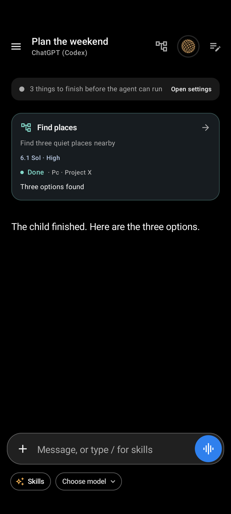

# Live child updates and parent wake-up — 2026-10-11

## Result

Public child messages now reach the parent during work, including commentary
between tools, text corrections and the complete final result. An idle parent
starts a normal turn automatically with its saved model and thinking level.
Voice receives the same quoted data and a speakable handoff. Child cards show
the latest public words and still open the ordinary child chat.

Events carry run-specific Stop fences. Startup and pending human gates hold
delivery. Child data cannot answer an approval/question, become a fake user
message, or replay uncertain work. Restart baselines existing history.

## Checks

| Area | Evidence |
|---|---|
| Final full gate | `gradlew.bat test assembleDevRelease assembleDevDebug assembleDevDebugAndroidTest :voice:lintDebug :app:lintDevDebug --no-daemon --no-parallel --max-workers=2`: passed in 1m38s; 1,168 tasks. A scoped Gradle home and storage init script kept other worktrees intact. |
| Unit variants | 2,390 XML executions, zero failures/errors, 16 skips. These are executions across variants, not unique tests. The focused suites contain 41 AgentRuns, 20 SessionAgents and four SessionAgentDelivery tests. |
| Runtime and hygiene | `python -m unittest tools.test_prepare_runtime`: 15 passed. `git diff --check` passed. App/voice lint passed without a baseline or weakened checks. |
| Final UI runner | Own API 35 emulator; manual `install -r` and direct `am instrument -w -e package dev.androidagent.app.ui dev.androidagent.app.dev.test/androidx.test.runner.AndroidJUnitRunner`: 34 passed in 49.136s. |
| Package | `dev.androidagent.app.dev`, Dev Debug, 1132, `0.14.0-dev.subagents4`; debug-key APK Signature Scheme v2 and 16 KiB zip alignment verified. Dev Release was built, not installed as a production release. |
| Xiaomi installation | Redmi 12 / Android 15, deliberately selected USB target; `install -r` succeeded. Package metadata and installed APK SHA match the exact final artifact. No uninstall or data clearing. |
| Data preservation | Private database/preferences tar kept before updates. Local copy comparison after final QA retained all 100 prior chat IDs, 1,876 message IDs and two draft IDs. No private data or raw phone captures were committed. |
| Final device gateway | Final-build child called `device_status` and `wait_for_change`. Accessibility remained bound. No live-run UI dump or physical-phone instrumentation was used. |

Final APK SHA-256:
`fcda113f32f7be6dca35c979c2a668ca6c1d4becebd5c3fedc04ce5ad8865683`.

## Physical runtime evidence

Typed QA used one source-user message. The child printed two progress markers
around device tools. Both reached the active parent before the child finished.
The parent's first turn ended; child completion then started a new parent turn
without polling or another user message. The new context arrived about 0.96s
after child completion, and the parent reported the result about 3.54s after it.
This flow was recorded on 1130; its delivery/coordinator code remains in 1132.

Voice QA first reproduced a separate mute problem: context and speech requests
were submitted, but speech waited until microphone unmute. On 1132, ADM mute
keeps microphone samples zero while leaving the media track live. The exact
bundled WebRTC 144.7559.09 bytecode was checked for zero replacement before
native transport. Stop/close still disable the track and mute capture/playback.

Final muted voice QA continued the same child through its ordinary chat. The
child printed `QA_MUTED_PROGRESS_ONE`, `QA_MUTED_PROGRESS_TWO`, and finally
`QA_MUTED_CHILD_DONE`. Current progress context was submitted before child
completion. The source's automatic spoken transcript contained all three
markers, without a source-user follow-up or unmute. A 30s state observation
recorded LISTENING/SPEAKING and a continuously active call. Source Return and
End voice succeeded. This proves that tested notification flow, not human
spoken task creation or an exhaustive audio/privacy audit.

## Regression coverage

- Message changes without a run-state change; append offsets, replacements,
  completion state, many messages and large Hebrew/emoji text without clipping.
- Active-parent updates, idle-parent wake, saved model/effort, startup delay,
  simultaneous siblings and ancestor routing.
- Stop before queued dispatch, Stop during context/speech delivery, deleted
  links, grandchildren, restart without replay and transport errors without retry.
- Delegated `yes` cannot approve or answer a child gate. Early messages reject
  without reserving their retry key; a later retry can succeed.
- UI progress revisions, terminal controls, parent reply and continued child
  navigation, plus the existing Hebrew/font/voice navigation fixtures.

## UI evidence

Synthetic Compose fixture, not a live model screenshot:

Private evidence remains under ignored `artifacts/subagents-device/live-updates/`:
`full-gate-1132.log`, `ui-tests-1132.log`, source/child traces, voice transcripts,
state observations, original/updated database archives and exact APKs.

## Remaining gaps

Human spoken child creation/steering, live remote-project SSH on the Xiaomi,
long-call/reconnect stress, and signed production-release installation remain
unverified. Earlier feature evidence and its gaps remain in [RESULTS.md](RESULTS.md).
